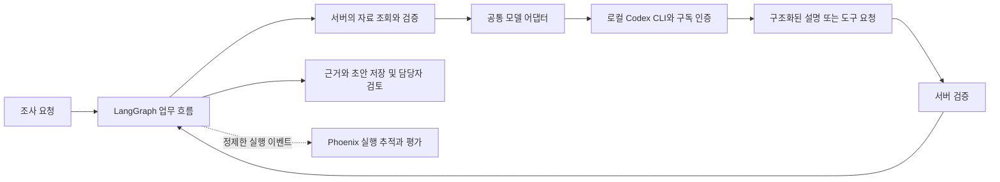

# HERMES 에이전트 엔터프라이즈 개발 계획

갱신일: 2026-10-21 · 계획 버전: 2.2 · 상태: 개발 구현 및 Phoenix 피드백 검증 진행

HERMES를 지역 근거 조사, 정책 탐색, 정책 초안, 담당자 검토와 후속 확인을 수행하는 에이전트로 발전시킨다. **LangGraph가 업무 흐름을 관리하고, 초기 개발·개인 시연의 모델 실행은 현재 ChatGPT 구독으로 인증된 로컬 Codex를 사용하며, 실행 추적과 평가는 Arize Phoenix로 통일한다.** 이후 공공기관·기업 내부망에 맞는 인증·저장·모델 실행 환경으로 확장한다. 이번 범위는 에이전트와 운영 기반이며 화면 구성은 포함하지 않는다.

## 1. 이번에 확정한 방향

| 항목 | 최신 계획 |
| --- | --- |
| 초기 LLM | 노트북의 공식 Codex CLI를 호출하는 개발용 어댑터. ChatGPT 로그인과 구독 한도 사용 |
| 첫 기능 | 서버가 조회한 공개 집계·공식 자료를 Codex가 요약하고 확인 질문을 제안하는 `single_search` 경로 |
| 오케스트레이션 | 기존 LangGraph 유지. 모델은 판단을 제안하고 Python 서버가 도구 허용 여부·인자·근거·저장을 검증 |
| 추적·평가 | OpenTelemetry 기반 실행 기록을 Phoenix에 연결하고 기준선·요약·도구 선택 전략을 비교 평가 |
| 주 관측 도구 | Phoenix로 확정. 로컬 개발은 SQLite로 시작하고 운영은 PostgreSQL과 기관별 격리를 검증 |
| 내부망 목표 | 기관 인증, 조직별 권한, PostgreSQL, 독립 worker, 감사 기록, 승인된 자료 반입, 내부 모델 또는 승인된 외부 연결 |
| API 결제 | 초기 개발의 선행 조건에서 제외. API 제공자는 선택 가능한 경로로 유지하며 자동 유료 전환은 하지 않음 |
| 작업 범위 | 에이전트·서비스·로컬 관측·평가·운영 기반 구현. 화면 변경 없이 실제 구독 실행과 실패 피드백 반복 |

Codex CLI의 ChatGPT 인증은 구독 접근을 지원하며 `codex exec`는 저장된 인증을 재사용한다. 구독 한도는 평소 Codex 작업과 공유하므로 무제한 호출이나 비용 0원의 운영 서버로 가정하지 않는다. [OpenAI 인증 문서](https://learn.chatgpt.com/docs/auth), [자동 실행 문서](https://learn.chatgpt.com/docs/non-interactive-mode)

## 2. 현재 구현과 확인한 경계

| 항목 | 2026-10-21 구현·검증 상태 |
| --- | --- |
| 구독 실행 | Codex CLI 0.163.0의 ChatGPT 인증을 재사용하는 `CodexSubscriptionProvider` 구현. API 키를 전달하지 않고 자동 유료 전환 없음 |
| 업무 흐름 | 실제 공개 자료로 `single_search`와 `agent` 실행 → 브리프 저장 → 사람 검토 대기 확인. agent 사례는 모델 호출 4회 |
| Phoenix | 20.23.0 로컬 HTTP 127.0.0.1:6006, 별도 영속 DB. 미사용 gRPC listener 비활성화. 실제 span·CODE 평가를 저장 후 DB에서 재조회 |
| 피드백 반영 | CLI 알림을 실패로 오인한 문제, 정상 GraphInterrupt를 오류로 기록한 문제 수정. 개인정보 입력을 요청할 수 있는 문구를 프롬프트 2.1에서 수정 |
| 자료 | 전국 I5 원본 해시·스키마·정확한 행정동 범위 연결. 활동 근거의 시군구·성별 계약 구현; 실제 활동 번들 부재는 unavailable로 반환 |
| 실행 신뢰성 | heartbeat·소유권 토큰·업무/체크포인트 fencing, 전체 작업 timeout, 프로세스 종료·회수, 모델 동시성 1, 재개·멱등성 부정시험 |
| 로컬 복구 | 업무/체크포인트 DB 쌍의 백업·해시·무결성 검사·새 경로 복원 구현. 실제 공개 자료 실행의 검토 대기 상태를 복원해 추가 모델 호출 없이 개발 검토 재개 확인 |
| 모델 계약 | 모델 설정·프롬프트·schema·도구 계약을 enqueue 시 고정. 설정 변경·없는 근거 ID·미허용 도구·순서 위반을 거부 |
| 기관 접근 기반 | RS256 JWT, issuer/audience/기간/기관 검증, 읽기·조사·검토·관리 권한, 검토자 기록, 업무·체크포인트 DB 기관 고정. 실제 SSO 미연결 |
| 기관 모델 | 승인된 내부 제공자 미구성. 기관 모드에서는 개인 구독을 조회하거나 실행하지 않으며 LLM 전략을 명시적으로 거부 |
| CI | agent/model 필수 설치 및 필수 suite·skip 검사. 최종 로컬 회귀 검사 311개 통과, skip 0. 원격 Actions 실행은 별도 확인 필요 |
| 평가 기준 | CODE 기준 1.1과 합성 반례 12개. 실제 I5 보류·실행별 근거 소유권 누락을 보강하고 기존 실제 실행을 재평가해 8/8 확인 |

세부 실행 ID와 검증 결과는 [구현·피드백 기록](IMPLEMENTATION_FEEDBACK_20261021.md), 운영 절차는 [Phoenix 운영 문서](PHOENIX_OPERATIONS.md)에 기록한다. 코드 기반 계약 검사 통과는 답변 품질·현장 효용·기관 운영 인증을 의미하지 않는다. 보조 의미 평가는 `annotator_kind=LLM`, `human_validated=false`, `release_gate=false`로 구분한다.

## 3. 개발용 실행 구조

다음은 로컬 개발에서 연결한 구조다. LangGraph가 업무 상태를 소유하고, Codex에는 해당 단계에 필요한 근거만 전달한다.

### 공통 모델 계약

- 요청: 조사 범위, 허용 근거, 가능한 행동, 남은 실행 예산, 프롬프트·자료 버전.
- 결과: `final` 또는 `tools`, 설명, 확인 질문, 근거 ID, 제한된 도구명·인자. JSON Schema와 서버 검증을 모두 통과해야 사용한다.
- 실행 정보: 제공자, 인증 방식, CLI 버전, 요청 모델, 실제 모델이 확인되면 그 값, 실행 시간, 성공 여부, 토큰 사용량.
- 오류: 인증 만료, 구독 한도 소진, 시간 초과, 취소, 형식 오류, 미허용 행동, 제공자 장애를 구분한다.
- 구현 설정: `DONGHAENG_PROVIDER=codex_subscription`(기본) 또는 `openai_responses`(명시 선택). `internal`은 승인된 내부 모델 계약과 함께 구현할 후속 단계다.

`single_search`는 설명 생성을 수행한다. 서버가 검색·상세 조회·조건 검사를 끝낸 뒤 Codex가 요약한다. `agent` 전략에서는 Codex가 도구 요청을 반환하면 서버가 허용 목록과 인자를 검사하고 실행 결과를 다음 단계에 전달한다.

CLI의 JSONL 이벤트와 구조화 출력은 공식 지원 경로를 사용한다. 프로세스 종료 코드만으로 성공 처리하지 않고 `turn.completed`, 최종 출력 존재, 스키마·근거 검증을 함께 확인한다. [OpenAI 자동 실행 문서](https://learn.chatgpt.com/docs/non-interactive-mode)

### 실행 통제

- CLI는 고정된 실행 파일과 인자 배열로 호출하고 요청 내용을 셸 명령에 보간하지 않는다.
- 업무 근거 전용 작업 공간과 제한된 권한을 사용한다. 초기에는 Codex 자체 셸·웹·MCP 도구가 업무 흐름 밖에서 실행되지 않도록 설정과 격리를 검증한다. 프롬프트 지시나 `read-only` 설정만으로 도구 차단이 완료됐다고 판단하지 않는다.
- 개인 설정·플러그인·장기 대화 내용이 평가에 섞이지 않도록 실행 설정과 입력을 고정한다. 플랫폼·조직의 권한 제한은 유지한다.
- 모델 요청 동시성은 1로 시작한다. 호출·검색·도구·전체 시간의 상한과 취소 시 프로세스 종료·회수를 구현한다.
- heartbeat·소유권 토큰과 업무/체크포인트 fencing을 구현했다. 모델 호출·도구 실행·저장을 합친 작업 전체 시간을 제한하고 종료 여유를 둔다. 취소·만료 후 도착한 결과가 사건을 완료 상태로 바꾸지 못하도록 검사한다. 다중 호스트 운영은 PostgreSQL 이행 후 별도로 검증한다.
- 구독 한도 소진과 인증 만료는 명시적인 대기·실패 상태로 처리한다. 새 계정 전환, 무한 재시도, API 유료 호출로 자동 전환하지 않는다.
- 공개 집계와 공개 이용이 허용된 공식 자료로 시작한다. 노트북에서 실행해도 추론은 외부 서비스에서 이뤄지므로 기관의 민감 자료를 투입하는 단계와 구분한다.

## 4. 에이전트 기능 범위

기능별 계약과 평가를 만들고 기존 그래프의 모듈로 구현한다. 기능 수만큼 독립 에이전트를 만드는 것을 목표로 삼지 않는다.

| 기능 | 구현 내용 | 검증 기준 |
| --- | --- | --- |
| 1. 최신 모델 근거 연결 | I5, 활동 관측, 품질·제한·출처 버전 조회 | 원본과 숫자·단위·근거 ID 일치 |
| 2. 조사 범위 계약 | 지역 코드·연령·성별·관측기간·조회시점·지원 범위 구분 | 제공되지 않은 세부 집단을 만들어내지 않음 |
| 3. 의도와 대화 문맥 | 설명·비교·지원 탐색·정책 초안·재조사 목적 식별 | 요청 목적과 범위 변경이 사건 버전에 반영 |
| 4. 지역과 집단 비교 | 비교 가능한 단위·기간만 비교하고 불일치 표시 | 서로 다른 모집단·시간 범위의 잘못된 순위 차단 |
| 5. 관측 해석과 검토 우선순위 | 수치 변화·자료 품질·추가 확인 이유 설명 | 고립 확률·진단·인과·자동 경보로 확장하지 않음 |
| 6. 외부 맥락 근거 | 공식 지역 공지·기상 등 필요한 자료 조회 | 관측기간·지역 일치와 취득 실패 표시 |
| 7. 공식 복지 검색 | 목록 검색, 원문 취득, 기간·조건 검증 | 고정 후보만 반환하는 한계 해소, 원문 없는 후보 구분 |
| 8. 관측과 지원 후보 연결 | 후보별 연결 이유와 확인할 조건 제시 | 미확인 자격을 `unknown`으로 유지 |
| 9. 정책 공백과 타 지역 사례 | 검색 범위 내 지원 차이·참고 사례 정리 | 검색 결과 없음과 정책 자체 부재를 구별 |
| 10. 정책 초안과 수정 | 대상·근거·사업 내용·운영 조건·평가안 생성 | 기존 정책과 신규 제안을 구별하고 추정치를 표시 |
| 11. 재조사 | 자료·원문·조건 변경을 비교하고 영향받은 판단 갱신 | 변경 없는 자료를 새 관측으로 보고하지 않음 |
| 12. 검토와 후속 조치 | 승인·기각·추가 확인·의뢰 보고·결과 확인 분리 | 승인 또는 의뢰 보고를 실제 지원 완료로 처리하지 않음 |
| 13. 결과와 보고서 | 근거가 연결된 설명·후보 비교·초안·이력 반환 | 주장과 원문 구절·수치의 대응을 추적 가능 |
| 14. 평가와 장애 처리 | 기준선 비교, 실패 분류, 취소·재개, 회귀 검증 | 실패를 가상 성공으로 대체하지 않음 |

I5는 전국 설문을 지역 인구구성으로 가중한 참고값이다. 지역 직접 설문·개인 고립확률·요청 연령 전용 점수로 설명하지 않는다. `hold`와 `operational_alert_allowed=false`를 유지하며 활동 관측과 임의 합산하지 않는다. [현재 모델 제한](../../model/final_model/reports/LIMITATIONS.md), [모델 인계 계약](../../model/final_model/reports/AGENT_HANDOFF.md)

## 5. Phoenix 적용 계획

주 관측·평가 도구는 Phoenix로 확정한다. 현재 필요한 로컬 실행 추적과 에이전트 품질 검증부터 구축하고, 기관 운영 요구를 별도의 배포 검증으로 확인한다. 모델·도구·검증 이벤트의 공통 계약은 앱이 소유하며 OpenTelemetry와 OpenInference 속성을 Phoenix에 맞춰 연결한다. 사용자 정의 Codex CLI 호출은 SDK 자동 계측만으로 포착된다고 가정하지 않고 앱에서 명시적으로 계측한다.

| 영역 | 구현할 내용 | 완료 기준 |
| --- | --- | --- |
| 로컬 배치 | 노트북의 로컬 접근으로 제한한 Phoenix와 영속 SQLite 저장소 | 재시작 후 실행 기록 유지, 업무 DB·체크포인트와 저장 경로 분리 |
| 실행 추적 | 한 `execution_id`에 trace를 연결하고 모델·도구·검증 단계를 span으로 기록. `case_id`로 재조사·재개 실행 연결 | 브리프에서 해당 실행과 단계별 근거·오류를 추적, 중복 span·누락 탐지 |
| 버전과 실험 | Git의 프롬프트 버전·자료 해시·schema·모델 설정을 기록하고 실패 사례를 평가 데이터셋으로 구성 | 같은 입력에서 규칙 기준선·Codex 요약·도구 선택 결과를 비교 가능 |
| 평가 | 코드 검사와 사람 검토 점수를 먼저 연결하고 이후 독립 모델 평가 작업의 점수·짧은 판정 이유를 연결 | 점수가 대상 실행·근거·평가 기준 버전과 연결되고 재현 가능 |
| 전송 신뢰성 | 마스킹 후 비동기 내보내기, 제한된 버퍼·재시도, 종료 시 전송 처리 | Phoenix 중단 시 업무 조회 영향과 trace 누락·복구를 검증 |
| 기관 운영 | Phoenix용 PostgreSQL, 기관별 인스턴스·DB, 인증·권한·보존·삭제·백업 | 조직 간 접근 차단, 복원, 선택한 망 정책에서의 실행을 검증 |

Phoenix는 로컬에서 SQLite를 사용할 수 있고 운영에는 PostgreSQL이 권장된다. 한 인스턴스를 하나의 tenant로 다루므로 기관 간 격리는 프로젝트 이름만으로 해결하지 않고 인스턴스·DB 경계로 설계한다. 기관 내부의 세부 권한 요구는 별도로 검증하며 Arize AX의 기능을 Phoenix의 기능으로 가정하지 않는다. [공식 아키텍처 문서](https://arize.com/docs/phoenix/self-hosting/architecture)

Phoenix는 코드 기반 검사와 모델 기반 평가를 지원한다. 우리 프로젝트의 자격 조건·수치·근거 ID 검사는 코드로 수행하고, 설명의 이해도와 정책 초안의 유용성은 사람 검토와 별도 평가 기준을 적용한다. [공식 평가 문서](https://arize.com/docs/phoenix/evaluation/llm-evals)

### 구독 사용량과 기록

- `provider=codex_cli`, `auth_mode=chatgpt_subscription`, `billing_mode=subscription`을 구분해 기록한다.
- 실제 반환된 입력·캐시·출력 토큰을 기록한다. 미제공 항목은 `null`로 두며 추정값과 구별한다.
- `model_call_succeeded`와 실행 ID로 성공 호출을 집계하고 기존 API 전용 집계를 교체한다.
- 구독 사용량을 API 단가로 곱해 실청구액으로 표시하지 않는다. 구독 실행의 `cost_usd`는 별도 과금 근거가 없으면 `null`이다. 도구가 자동 산출한 API 환산 비용도 실제 구독 비용 지표와 분리한다.
- 구독 잔여율은 해당 계정의 조회 시점 정보이며 토큰 수로 역산하지 않는다. 평소 개발 작업도 같은 한도를 소모한다.
- 인증 파일·토큰·개인정보·원본 진단 로그·내부 추론 전문은 trace에 넣지 않는다. 필요한 입력 요약·구조화 결과·짧은 행동 이유·오류 코드만 보낸다.
- 마스킹은 모델 입력과 Phoenix로 내보내는 관측 데이터 모두에 전송 전에 적용한다. 평가 데이터셋과 재전송 버퍼에도 같은 기준을 적용한다.

평가 심사기는 앱의 독립 평가 작업으로 구성해 같은 제공자 계약을 사용하고 평가 결과를 Phoenix에 기록한다. 개인 구독 인증 파일은 Codex 실행 환경에서만 관리한다. 먼저 코드 검사와 사람 검토를 적용하고, 모델 평가기는 구독 한도를 고려한 보조 점수로 추가한다.

업무 기록·체크포인트·감사 기록·관측 trace는 각각의 목적과 보존 정책을 둔다. trace 장애가 일반 조회를 중단시키지 않도록 제한된 재전송을 설계하되, 필수 감사 기록을 저장하지 못한 승인·외부 행동은 진행하지 않는다.

## 6. 구현 순서와 단계별 완료 기준

| 단계 | 구현 범위 | 다음 단계로 넘어갈 증거 |
| --- | --- | --- |
| P0 실행 기반 정리 | 서비스 조립 오류, 최신 자료 계약, 제공자 주입, 공통 결과·오류·사용량, 실제 에이전트를 포함하는 CI 경로 | 규칙 기준선 실행과 사건 저장·검토·재개, 자료 범위 오류 거부, 제공자 교체 계약 검사 |
| P1 Codex 구독으로 첫 업무 검증 | `single_search` 요약, 구조화 결과 검증, 한 작업만 실행, 시간 제한·취소·구독 오류, 로컬 Phoenix와 최소 trace | 공개 근거 조회 → Codex 설명 → 근거 검사 → 브리프 저장 → 검토 대기까지 실제 실행하고 Phoenix에서 해당 기록 확인 |
| P2 조사 기능 확장 | 서버가 실행하는 도구 선택 루프, 공식 자료 수집·검색 개선, 범위·비교·재조사·초안 등 14개 기능의 순차 확장 | 근거 부족·만료·조건 불일치에 따라 다음 조회나 보류가 달라지는 기록, 미허용 행동 차단 |
| P3 평가와 운영 안정화 | Phoenix 데이터셋·실험과 잠금 평가, heartbeat·fencing, 독립 worker, 업무·체크포인트·Phoenix 저장소별 PostgreSQL 이행·복구 검증 | 전략별 품질·사용량 비교, 재개·중복 방지 결과, 추적 누락 검사, 저장소별 백업 복원 |
| P4 기관 내부망 전환 | 기관 SSO·조직 권한, 자료 반입, 내부 모델 또는 승인된 외부 연결, 비밀 관리·감사·배포·롤백 | 모델 교체 회귀 평가, 조직 간 접근 차단, 선택한 망 정책에서의 실행, 장애·복구·운영 인수 시험 |

P1에서 기준선·오류 검사를 함께 시작하고 P2 기능을 추가할 때마다 회귀 사례를 늘린다. P2의 전체 작업 시간이 lease를 넘을 수 있으면 heartbeat·fencing을 P3에서 앞당겨 구현한다. P3까지 평가를 미루지 않는다. 기관용 보안·자료 계약도 초기에 정의하되 GPU 구축과 실제 기관 배포는 업무 효용을 검증한 뒤 진행한다.

### 첫 구현 묶음과 다음 단계

1. `provider.py`와 `graph.py`의 제공자 결합을 풀고 공통 요청·결과를 정의한다.
2. `legacy_main.py`의 도구 생성 오류와 최신 모델 조회 계약을 정리한다.
3. CLI 실행 어댑터, 출력 schema, 취소·오류 처리, 제공자별 readiness를 구현한다.
4. `single_search`로 실제 공개 근거 한 건의 조사 브리프를 저장하고 검토 대기까지 확인한다.
5. 로컬 Phoenix를 연결하고 동일 사건의 실행·도구·모델·검증 기록과 코드 평가 점수를 확인한다.

첫 묶음과 제한된 도구 선택 경로를 구현·검증했다. 다음 작업은 실제 활동 번들 연결, 공식 검색·비교·정책 초안 등 남은 기능, 독립 평가와 PostgreSQL/내부 제공자 전환이다. 현재 결과는 14개 기능 전체나 기관 운영 완료를 의미하지 않는다. 단계별 결과에 따라 지연·동시성·호출 예산을 조정한다.

## 7. 평가 설계

비교 대상은 **규칙 기준선 → Codex 요약 → Codex 도구 선택**이다. 같은 자료 스냅샷과 사례를 사용하며 모델·프롬프트·schema·도구 버전과 사용량을 함께 기록한다. 사례와 결과는 Phoenix의 데이터셋·실험·평가 기록으로 연결한다. 먼저 작은 개발 사례로 계약을 검증하고, 합격 기준과 반복 횟수를 확정한 후 별도 잠금 평가를 수행한다.

| 평가 축 | 사례와 판정 |
| --- | --- |
| 자료 정확성 | 숫자·단위·지역·시점·근거 ID와 `null`/0 구별을 코드로 검사 |
| 해석 경계 | I5의 개인 확률화, 자료 없는 세부 집단 생성, 인과 단정·자동 경보를 반례로 검사 |
| 공식 지원 | 만료·지역 불일치·상세 미취득·개인 조건 미확정에서 제외 또는 `unknown` 유지 |
| 도구 통제 | 없는 도구·미등록 후보·잘못된 인자·반복 검색·문서 속 지시문 실행 차단 |
| 실행 신뢰성 | 로그인 만료·한도 초과·CLI 오류·취소·중복 요청·worker 중단·재개·늦은 완료 처리 |
| 담당자 효용 | 근거 이해, 확인 질문, 정책 초안의 실무 유용성·검토 소요를 사람 검토로 측정 |
| 자원 사용 | 성공 사건당 모델 호출·도구 호출·토큰·대기시간·실패율 비교 |

필수 반례의 금지 행동은 0건을 통과 기준으로 삼되, 제한된 평가의 0건을 전체 환경의 무오류로 해석하지 않는다. 모델 심사 점수와 담당자 승인도 객관적 정답이나 실제 지원 성과를 대신하지 않는다. 에이전트가 단순 요약보다 유용하지 않으면 루프를 축소한다.

## 8. 내부망 운영으로 전환할 때

개인 구독 기반 로컬 실행은 개발·개인 시연 단계의 선택이다. 기관의 공용 업무 서버나 불특정 사용자가 호출하는 서비스에 개인 로그인을 공유하지 않는다. 완전 폐쇄망에서는 외부 Codex 추론을 직접 호출할 수 없으므로 내부 모델 실행 경로가 필요하다.

- **모델:** 동일 어댑터 계약으로 내부 제공자를 연결한다. 구조화 출력·도구 요청·문맥 길이·품질·지연을 다시 평가하며 URL 교체만으로 동등성을 가정하지 않는다.
- **접근:** 기관 SSO, 사용자·조직·사건 단위 권한을 API와 도구 조회 양쪽에서 검증한다. 검색 인덱스와 평가 데이터에도 동일한 접근 경계를 적용한다.
- **자료:** 승인된 외부 수집 구간과 내부 반입 구간을 분리하고 원문 해시·버전·권리·만료·변경 이력을 관리한다.
- **저장:** PostgreSQL 업무 DB와 체크포인트를 이행하고 trace·감사 기록과 구분한다. 백업 복원, 데이터 삭제, 보존 기간을 실제로 검증한다.
- **실행:** 독립 worker, 작업 소유권·heartbeat·fencing, 제한된 재시도와 실패 작업 보관을 도입한다. 외부 행동에는 승인된 내용과 멱등성 키를 연결한다.
- **배포:** 의존성·컨테이너·모델을 버전 고정하고 내부 저장소 반입, 취약점 검사, 설정 변경 이력, 단계 배포·롤백을 준비한다.
- **관측:** Phoenix를 기관별 인스턴스·DB로 배치하고 기관 내부의 세부 권한과 운영 지표·경보 연결을 검증한다. 라이선스·원격 진단·외부 리소스·평가기의 모델 연결을 확인하고 선택한 망 정책에서 필요한 기능을 시험한다.
- **운영 기준:** 예상 사용자·동시 작업·자료량을 정한 뒤 가용성·응답시간·복구 목표를 합의하고 부하·장애 시험으로 확인한다.

현재 확정된 우선순위는 **Codex 구독으로 실제 조사 흐름 검증 → Phoenix 추적과 전략별 평가 → 기능 확장과 실행 안정화 → 기관 환경 전환**이다. 관측·평가는 Phoenix로 진행하며, 기관 모델과 배포 규모는 해당 단계의 검증 결과를 근거로 정한다.
