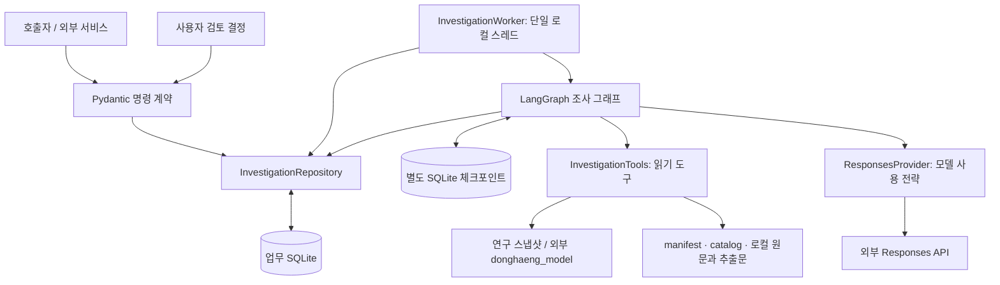
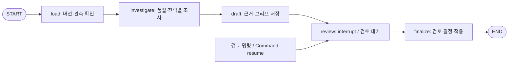

# 동행 조사 에이전트: 피처·아키텍처·구현 상세 명세

작성 기준: 2026-10-12, 현재 `agent/` 소스, 패키지 버전 `0.1.0`. 이 문서의 **구현됨**은 코드가 존재한다는 의미다. 실행 성공이나 모델 성능 검증은 별도 근거가 있는 경우에만 표시한다.

## 1. 목적과 구현 범위

동행 조사 에이전트는 지역·연령·관측월을 지정하면 공개 연구 스냅샷의 관측을 읽고, 보관된 공식 지원정보의 조건을 확인해 사람이 검토할 조사 브리프를 만든다. 브리프에는 관측, 지원 후보, 제외 사유, 확인 질문, 다음 행동과 출처 근거가 포함된다. 사용자 검토에서 실행을 중단하고 검토 결정 후 같은 그래프를 재개한다.

현재 패키지에는 연구 조사 흐름과 합성 시연 흐름이 함께 있다. 연구 조사 흐름은 별도의 개인 고립 위험점수를 계산하지 않는다. 합성 시연의 `risk_score`와 등급은 실제 조사 결과로 사용하면 안 된다.

### 1.1 기능별 상태

| 기능 | 코드 구현 | 실행 조건·실제 범위 | 주요 근거 |
| --- | --- | --- | --- |
| 조사 사건 생성·조회·목록 | 구현됨 | 로컬 업무 SQLite, 명령 입력은 호출자가 계약 검증 | [repository.py](../src/donghaeng_agent/repository.py) |
| 설문·행동·SK 관측 조회 | 구현됨 | `donghaeng_model`과 유효 연구 스냅샷 필요 | [tools.py](../src/donghaeng_agent/tools.py) |
| 관측 품질 검사·추가 질문 | 구현됨 | 결정적 규칙; 고립 위험 임계값으로 검증되지 않음 | [tools.py](../src/donghaeng_agent/tools.py) |
| 공식 지원 후보 검색 | 구현됨 | 고정 manifest의 보관 자료 조회; 실시간 검색 아님 | [tools.py](../src/donghaeng_agent/tools.py) |
| 중앙 지원 카탈로그 검색 | 구현됨 | 로컬 목록과 원본 해시 필요; 메타데이터 수준 | [tools.py](../src/donghaeng_agent/tools.py) |
| 원문·추출문 검증 | 구현됨 | 로컬 원문·추출문 필요; 현재 폴더에는 해당 파일 없음 | [tools.py](../src/donghaeng_agent/tools.py) |
| 지역·연령·기간 조건 검사 | 구현됨 | `match` / `no_match` / `unknown`; 개인 자격 확정 안 함 | [tools.py](../src/donghaeng_agent/tools.py) |
| 규칙 기반 브리프 | 구현됨 | 모델 없이 실행 가능하나 관측·자료 의존성 필요 | [graph.py](../src/donghaeng_agent/graph.py) |
| 검색 1회 후 모델 요약 | 구현됨 | 모델 설정·키·네트워크 필요; 보존 평가에서 미실행 | [graph.py](../src/donghaeng_agent/graph.py) |
| 모델의 반복 도구 선택 | 구현됨 | 호출 예산 적용; 보존 평가에서 실제 모델 미실행 | [provider.py](../src/donghaeng_agent/provider.py) |
| 사람 검토·중단·재개·재시도 | 구현됨 | 별도 SQLite 체크포인트와 단일 로컬 worker | [worker.py](../src/donghaeng_agent/worker.py) |
| 출처 재확인·오래된 근거 표시 | 구현됨 | 로컬 스냅샷·캡처 비교; 최신 웹 원문 재취득 안 함 | [tools.py](../src/donghaeng_agent/tools.py) |
| 후속 기록 | 부분 구현 | `referral_reported`, `closed` 저장 가능; 연결·참여 확정 차단 | [repository.py](../src/donghaeng_agent/repository.py) |
| 날씨·휴일 등 맥락 조회 | 미연결 | 도구는 `context_connector_not_configured` 반환 | [graph.py](../src/donghaeng_agent/graph.py) |
| 화면·FastAPI·HTTP 경로 | 외부 구성요소 | README가 형제 `service/`에 위임; 현재 작업 폴더에 없음 | [README](../README.md) |
| 지수 산출·학습·스냅샷 계약 | 외부 구성요소 | 형제 `model/`에 위임; 현재 작업 폴더에 없음 | [pyproject.toml](../pyproject.toml) |

외부 연락·신청 실행, 개인 진단, 미래 고립 예측, 활동 변화의 인과 확정, 예방 효과 측정은 구현된 조사 기능에 포함되지 않는다.

## 2. 아키텍처

### 2.1 구성요소와 책임



| 구성요소 | 책임·대표 인터페이스 |
| --- | --- |
| [contracts.py](../src/donghaeng_agent/contracts.py) | 사건·실행·검토·재확인·재시도·후속 기록 요청 검증. 응답 전체를 모델로 정의하지는 않음 |
| [graph.py](../src/donghaeng_agent/graph.py) | `build_investigation_graph(repo, tools, saver)`; 관측부터 브리프·검토까지 순서 제어 |
| [tools.py](../src/donghaeng_agent/tools.py) | 스냅샷·공식 캡처 읽기, 조건 비교, 출처 재확인 |
| [provider.py](../src/donghaeng_agent/provider.py) | `ResponsesProvider.readiness()`, `decide(messages, allow_tools=True)`; 모델 호출과 응답 추출 |
| [repository.py](../src/donghaeng_agent/repository.py) | 업무 데이터·명령 재생·작업 큐·도구 결과 저장 |
| [worker.py](../src/donghaeng_agent/worker.py) | `start()`, `drain_once()`, `close()`; 작업 확보·그래프 실행·체크포인트 재개 |

호출자가 Pydantic 모델을 검증하고 `model_dump(mode="json")`로 저장 가능한 딕셔너리를 만든 뒤 저장소에 전달하는 구조다. 저장소 메서드는 자체적으로 Pydantic 검증을 수행하지 않는다. 특히 `support_as_of`는 계약에서 `date`이지만 저장·조건 비교에서는 JSON 날짜 문자열을 사용한다.

### 2.2 그래프 흐름



| 노드 | 입력·처리 | 상태에 추가되는 결과 |
| --- | --- | --- |
| `load` | 사건·실행 조회, 예약 시점과 현재 스냅샷·manifest 해시 비교, 관측·근거 저장 | `measurements` |
| `investigate` | 해시 재비교, 품질 검사, 선택 전략으로 검색·상세·조건 확인 | `quality`, `details`, `checks`, `model_metrics`, `model_note` |
| `draft` | 검증 가능한 후보·제외 사유·미확정 질문 조립, 공식 근거·브리프 저장 | `brief` |
| `review` | 사건·실행·브리프 ID/버전, 질문, 허용 결정을 `interrupt()`로 전달 | 재개 후 `review` |
| `finalize` | `accept`, `reject`, `request_info`에 따른 사건 상태 변경 | 추가 상태 없음 |

`InvestigationState`는 `TypedDict(total=False)`이며 ID와 각 단계 결과를 담는다. 이 타입 선언 자체가 런타임 데이터 검증을 수행하지는 않는다. 그래프의 외부 노드 순서는 고정이고, 전략 분기와 반복 모델 호출은 `investigate` 내부에 있다.

### 2.3 실행 전략

| 전략 | 조사 방식 | 모델 사용 | 특이사항 |
| --- | --- | --- | --- |
| `rule_baseline` | 지원 검색 1회, 앞의 최대 4개 후보를 상세 조회·조건 검사 | 없음 | 품질 규칙이 맥락 확인을 요구하면 미연결 맥락 도구 결과도 기록 |
| `single_search` | 같은 검색·후보 검사 후 결과 요약 | 도구 없이 1회 | `model_note`에 요약 저장; 별도 구조화 질문 추출은 하지 않음 |
| `agent` | 모델이 허용된 읽기 도구를 순차 선택 | 최대 5라운드 | 검색으로 얻은 후보 ID만 상세·조건 조회 허용 |

`agent`는 최대 모델 선택 도구 12회, 지원 검색 2회다. 5번째 응답까지 모두 도구 호출을 요구하면 `model_round_budget_exhausted`로 실패한다. 도구 호출이 없는 응답에서 종료하며, 검색·상세·조건을 반드시 완료했는지 별도 완료 검사를 하지는 않는다. 확인한 상세·조건이 없는 경우에는 지원 후보가 없는 브리프가 만들어질 수 있다.

모델 반복문은 매 라운드 시작에 경과 시간 90초를 검사한다. 전체 작업을 정확히 90초에 강제 종료하는 타이머는 아니다. worker의 그래프 `recursion_limit`은 30이다.

## 3. 데이터 입력 피처와 해석

근거: [tools.py의 `resolve_region`, `measurements`, `quality`](../src/donghaeng_agent/tools.py). 지수 산출식·전체 원천 스키마는 외부 `donghaeng_model`의 소유이며 이 폴더만으로 확인할 수 없다. 아래는 에이전트가 실제로 읽거나 사용하는 필드다.

### 3.1 관측 유형

| 관측 | 공간·모집단·시간 단위 | 사용하는 필드·조건 | 해석 |
| --- | --- | --- | --- |
| `survey` | 서울 자치구 × 요청 연령집단, 설문 연도 | `score`, `n`, `n_eff`, `quality`, `ci_low`, `ci_high`, `support_absence`, `loneliness` | 직접응답 구성지수 0~100; 동별·개인 라벨 아님 |
| `behavior` | 요청 도시·동·관측월, 고정 20~39세 모집단 | 일치 레코드의 `score`와 모델 직렬화 결과 | 지역 행동 대리지수 0~100; 20대/30대별 점수로 복제하지 않음 |
| `sk` | 요청 도시·동·20대/30대, 선택월까지 제공 관측 거점 | `flow_total`, `change_pct`, `coverage`, `quality`, 좌표 수·기간 | 제공 유동량; 주민 수·고유 방문자 수·고립 라벨 아님 |

지역은 이동 관측과 행동지수 레코드에서 `city`와 `dong_code`가 정확히 일치해야 한다. 해당 지역이 존재해도 실제 사용할 관측이 충분하다는 뜻은 아니다. 관측월은 이동 자료의 기간 목록 또는 행동지수 기준 기간에 있어야 한다. 설문은 서울과 자치구·연령으로 찾으며, 자치구 값을 동별 점수로 재계산하지 않는다.

설문 공개 조건은 `score != None`, `n >= 30`, `n_eff >= 20`, `quality == "adequate_descriptive_sample"`를 모두 만족하는 것이다. 미충족 시 `score`, 신뢰구간, `support_absence`, `loneliness`를 `None`으로 가리고 `held`를 반환한다. 조건을 충족해도 지원망 부재·외로움 50/50 구성은 규범적 지수이며 진단 확률이 아니다.

### 3.2 SK 피처·모드·품질 규칙

| 필드 | 정의·활용 |
| --- | --- |
| `selected` | 요청한 정확한 관측월의 레코드; 이전 유효월로 대체하지 않음 |
| `window` | 같은 도시·동·연령에서 선택월 이하인 레코드를 월순 정렬 |
| `missing_periods` | 스냅샷 기간 목록 중 선택월 이하이며 유효 `flow_total`이 없는 월 |
| `baseline_months` | 고정 `2025-07`, `2025-08` |
| `baseline_complete` | 두 기준월 레코드 모두 존재, 유동량이 null이 아니고 coverage가 1 |
| `baseline_numeric` | 기준월이 완전할 때 두 유동량 평균; 그렇지 않으면 null |
| `baseline_coverage` | 기준월별 coverage·고정 좌표 수·관측 좌표 수 |
| `reference_available_after` | `2025-08`; 선택월이 그보다 빠르면 사후 기준평균 사용임을 표시 |
| `footprint`, `reference_period` | 이동 스냅샷의 관측 거점·기준 기간 메타데이터 |

`sk_mode="provided"`는 제공 관측을 사용한다. `excluded`는 SK 관측을 결과에서 제외하며 설문·행동 관측은 유지한다. `quality_mutation`은 평가용으로 선택월 유동량·변화율을 null, coverage·관측 좌표 수를 0으로 바꾼다. 메모리의 평가 레코드에만 적용하고 원자료 파일을 수정하지 않는다.

SK의 `available`은 선택월 유동량 존재, coverage ≥ 1, 누락월 없음, `quality == "complete_fixed_footprint"`일 때다. 선택월 유동량만 존재하면 `partial`, 유동량이 없고 평가 변조 모드이면 `held`, 나머지는 `unavailable`이다. 모든 포함 관측이 `available`이면 전체 `measurement_status`가 `available`, 아니면 `partial`이다. 실제 관측값 0은 null과 구분한다.

품질 검사는 다음 질문과 행동을 생성한다.

| 트리거 | 행동·확인 질문 |
| --- | --- |
| 어떤 관측이든 `available`이 아님 | `request_measurement_evidence`; 지역·관측시점 근거 추가 확보 요청 |
| SK가 available이고 `abs(change_pct or 0) >= 10` | `check_context`; 기상·휴일·거점 대표성 확인 |
| SK가 available이고 기준월 평균 < 1000 | `check_small_base`; 작은 기초량과 절대량·거점 대표성 검토 |

이 기준은 개발용 조사 규칙이다. 원인·인과관계나 고립 위험 컷오프를 확정하지 않으며 `causal_claim_allowed=False`를 반환한다. 관측 부족이 연구 그래프 전체를 자동 중단시키지는 않는다. 부족 상태·질문을 보존한 채 지원 조사와 브리프 작성으로 진행한다.

### 3.3 목적 필드의 현재 활용

`purpose`는 사건 요청과 브리프 `scope`에 저장되고 모델 입력의 scope에도 포함된다. 결정적 지원 검색·조건 검사에서는 목적 문구에 따른 분류나 점수화를 구현하지 않았다. 신한카드·MOIS 원본 수백 컬럼을 조사 에이전트가 직접 가공하는 경로도 없다.

## 4. 명령 입력 계약과 Python 인터페이스

근거: [contracts.py](../src/donghaeng_agent/contracts.py), [repository.py](../src/donghaeng_agent/repository.py). 아래는 Python 계약이며 HTTP 경로나 응답 상태코드를 새로 정의하지 않는다. 모든 명령은 미정의 필드 입력을 금지한다(`extra="forbid"`). Pydantic의 별도 strict 타입 모드는 설정하지 않았다.

### 4.1 사건 생성: `InvestigationRequest`

| 필드 | 타입·제약 | 기본값 |
| --- | --- | --- |
| `region_code` | 문자열, 정규식 `^\d{10}$` | 필수 |
| `age_group` | `20대` 또는 `30대` | 필수 |
| `city` | `서울` 또는 `춘천` | 필수 |
| `purpose` | 문자열 1~500자 | 필수 |
| `measurement_as_of` | `YYYY-MM`, 월 01~12 | 필수 |
| `support_as_of` | `date`, JSON에서는 날짜 문자열 | 필수 |
| `sk_mode` | `provided`, `excluded`, `quality_mutation` | `provided` |
| `idempotency_key` | 문자열 8~128자 | 필수 |

날짜·문자열 형식 검증과 실제 스냅샷에 지역·월이 있는지 확인하는 작업은 다르다. `resolve_region(request)`를 통해 실제 지원 범위를 확인해야 한다. `create(request)` 자체는 지역 존재 여부를 검사하지 않는다.

### 4.2 변경 명령

모든 변경 명령은 `expected_case_version: int >= 1`, `idempotency_key: str` 8~128자를 필수로 받는다.

| 계약 | 추가 필드·기본값 | 저장소 인터페이스 |
| --- | --- | --- |
| `RunCommand` | `strategy`: `rule_baseline`(기본), `single_search`, `agent` | `enqueue(case_id, request, versions)` |
| `ReviewCommand` | `brief_id: str`, `brief_version >= 1`, `decision`: `accept`/`reject`/`request_info`, `reason` 1~2000자, `reviewer_type`: `user`(기본)/`developer_verification` | `review(case_id, request)` |
| `RecheckCommand` | 추가 필드 없음 | `record_recheck(case_id, request, changes)` |
| `RetryCommand` | `execution_id: str` | `retry(case_id, request)` |
| `FollowupCommand` | `status`: `referral_reported`/`connection_confirmed`/`participation_confirmed`/`closed`, `evidence_ids`: 1개 이상 문자열, `note` 1~2000자 | `followup(case_id, request)` |

`FollowupCommand`는 연결·참여 확인 상태도 형식상 허용하지만 저장소는 두 상태를 `field_evidence_required`로 거부한다. `closed`는 후속 기록 값이며 사건의 `status`를 closed로 바꾸지 않는다. `request_info`는 사건을 `awaiting_info`로 만들고 해당 실행을 완료한다. 추가 정보 답변 전용 계약이나 검토 노드 자동 재진입은 없다.

### 4.3 호출과 반환

| 메서드 | 주요 반환 필드·동작 |
| --- | --- |
| `create(request)` | `case_id`, `case_version=1`, `status="draft"` |
| `enqueue(...)`, `retry(...)` | `case_id`, `case_version`, `execution_id`, `status="queued"` |
| `review(...)` | 위 queued 응답 + `review_id`; 검토를 저장하고 resume 작업 등록 |
| `record_recheck(...)` | `case_id`, `case_version`, `changes`, `requires_new_run`, `recheck_id` |
| `followup(...)` | `case_id`, `case_version`, `followup_id` |
| `get(case_id)` | 사건 메타데이터·request와 `briefs`, `reviews`, `followups`, `evidence`, `events`, `executions`; 각 실행에 `tool_calls`; `schema_version="investigation-1.0"` |
| `list()` | 수정 시각 내림차순의 전체 사건 상세 목록; 페이지네이션 없음 |
| `execution(execution_id)` | 실행 ID·전략·상태·그래프 thread ID·버전·메트릭·오류·시각 |

명령 재전송은 저장된 응답을 반환하므로 그 응답의 사건 버전이 현재 최신 버전이라는 보장은 없다. 다음 변경 전 `get()`으로 확인한다. 재확인 호출자는 `tools.recheck(repo.get(case_id))`로 계산한 변경 목록을 `record_recheck()`에 전달해야 한다. 저장소가 직접 파일을 재조회하지는 않는다.

## 5. 읽기 도구와 공식 조건 검사

### 5.1 모델 공개 도구

근거: [provider.py의 `TOOL_SCHEMAS`](../src/donghaeng_agent/provider.py), [graph.py의 dispatch](../src/donghaeng_agent/graph.py). 스키마는 `strict=True`, `additionalProperties=False`이며 정의된 필드를 모두 required로 만든다. 지역·기준 날짜는 모델 인자로 받지 않고 사건 요청에서 가져온다.

| 모델 도구 | 인자 | 실제 동작·결과 |
| --- | --- | --- |
| `inspect_observation_quality` | `{}` | 이미 계산된 `quality` 반환: status·actions·questions·규칙 설정 |
| `get_context_evidence` | `{}` | `unavailable`, `context_connector_not_configured` 반환 |
| `search_official_support` | `support_type: string`, `exclude_ids: string[]` | `tools.search()`; status·candidates·retrieval_mode·조회 시각·경고 |
| `fetch_support_details` | `candidate_id: string` | `tools.details()`; 원문·추출문·조건 인용 검증 |
| `check_support_conditions` | `candidate_id: string` | 가져온 상세로 `tools.check_conditions()`; 자격 상태·조건·제외 사유 |

검색에서 반환된 ID만 상세·조건 조회에 사용할 수 있다. 조건을 상세보다 먼저 조회하면 unavailable 상세를 검사한 결과가 된다. 미허용 도구 이름, 후보 ID, 초과 검색은 실행 오류로 처리한다. 품질 도구 결과는 이미 저장된 것을 반환하므로 모델 선택 도구 12회 예산과 DB `tool_calls` 행 수는 일치하지 않을 수 있다.

`support_type`은 현재 결과에 표시할 뿐 후보를 필터링하지 않는다. `search()`는 사건 지역·나이로 사전 필터하거나 의미 검색·랭킹하지 않고 manifest의 전체 후보에서 `exclude_ids`만 제외한다. 관련 범위의 확정은 후속 조건 검사에서 수행한다.

### 5.2 일반 Python 메서드

| 메서드 | 입출력·중요 동작 |
| --- | --- |
| `versions()` | 스냅샷·manifest SHA-256와 `tool_version`, `graph_version`, `prompt_version` 반환; manifest 부재 시 해당 해시는 null |
| `resolve_region(request)` | 도시·지역 코드·관측월 확인 후 `dong_name`, `district` 반환 |
| `measurements(request, execution_id)` | `status`, `scope`, `observations`, `evidence`, `sk_mode`, `snapshot_version`, `measurement_status` |
| `quality(measurements)` | `status`, `actions`, `questions`, `context_connector`, `causal_claim_allowed`, `rule_config` |
| `manifest()` | JSON 읽기; 파일 부재 시 sources가 빈 unavailable 결과 |
| `catalog_search(query="", limit=20)` | 카탈로그 title·summary·ministry·service_id에 공백 분리 검색어가 모두 포함되는 항목; 대소문자 무시; 반환 개수 1~100으로 제한 |
| `source_path(value)` | 주입된 resource root 기준 절대 경로 해석 및 허용 디렉터리 확인 |
| `support_signature(source)` | 조건·지역·연령·기간·연락처·URL·요약의 결정적 메타데이터 해시 |
| `recheck(case)` | 저장 근거와 현재 로컬 자료의 비교 목록 반환; 저장소 변경 없음 |

`catalog_search()`는 모델 도구 목록이나 조사 그래프의 지원 검색에 자동 연결되지 않는다. 목록은 `detail_verified=False`, `eligibility_status="unknown"`, `verification_level="metadata_only"`로 반환한다. 카탈로그 원본 파일의 SHA-256을 검증하지만 파생 `catalog.json` 자체의 별도 해시는 확인하지 않는다. 파일 부재·잘못된 JSON 등 모든 예외를 상태 응답으로 변환하는 것도 아니다.

### 5.3 상세 출처 검증

`details(candidate_id)`는 manifest의 `sources`에서 ID를 찾아 다음 순서로 검사한다.

1. `capture_path` 원문 바이트의 SHA-256이 `sha256`과 같은지 확인한다.
2. `content_text_path` 추출문의 SHA-256을 계산한다. `content_text_sha256`이 있으면 대조한다.
3. 구조화 조건의 비어 있지 않은 `source_quote`가 추출문에 포함되는지 검사한다.
4. 성공 시 `source`, `content_hash`, `text_hash`, `metadata_hash`, `capture_verified=True`, `retrieval_mode="verified_local_official_capture"`를 반환한다.

허용 경로는 manifest 디렉터리와 주입된 `capture_root`다. 상대 경로는 `resource_root` 기준이며 `resolve()` 후 경계를 검사하므로 `..`이나 외부로 나가는 심볼릭 링크를 허용하지 않는다. 이는 공식 상세 파일 읽기의 제한이고 스냅샷 읽기 경로에 동일 검사를 적용하지는 않는다.

### 5.4 조건의 3값 판정

| 조건 | `match` | `no_match` | `unknown` |
| --- | --- | --- | --- |
| 지역 | 사건 도시가 대상 목록에 있거나 `전국` 포함 | 지역 목록이 있으나 불일치 | 목록 없음 |
| 연령집단 | 공식 최소·최대 연령이 20~29 또는 30~39 전체를 포함 | 두 구간이 완전히 분리 | 경계 일부만 겹침 또는 연령 정보 부재 |
| 접수 기간 | status가 open이고 시작·종료 날짜가 모두 존재하며 범위 내 | 시작 전, 종료 후, status closed | 날짜·상태 불충분 |
| 원문 조건 | `kind=age`와 `operator=between`이면 위 연령 결과, `kind=geography`이면 위 지역 결과 | 같은 비교 규칙의 불일치 | 소득·가구·거주 사실 등 나머지 개인 조건 |

접수 날짜 경계는 포함된다. 하나라도 `no_match`면 후보를 제외하고 `eligibility_status="excluded"`로 표시한다. 나머지는 `needs_confirmation`이며, 현재 접수 수용 확정을 뜻하는 `currently_accepting_confirmed`는 항상 false다. 필요한 경우 별도 `individual_eligibility=unknown` 조건을 추가한다. 상세 검증 실패는 `unverified_source`, excluded 결과가 된다.

## 6. 브리프와 근거 출력

근거: [graph.py의 `draft`](../src/donghaeng_agent/graph.py), [repository.py의 `put_brief`](../src/donghaeng_agent/repository.py). 브리프는 Python 딕셔너리이며 별도의 Pydantic 응답 모델로 검증하지 않는다.

| 필드 묶음 | 구조·의미 |
| --- | --- |
| 식별·버전 | `schema_version="investigation-brief-1.0"`, `case_id`, `execution_id`, `brief_id`, `brief_version`, `version`, `created_at` |
| 범위·관측 | `scope`: 사건 요청 + 동 이름·자치구; `observations`: kind·status·data·evidence_id·모집단·기간·제약 |
| 지원 후보 | `support_candidates`: ID·제목·URL·요약·연락처·conditions·eligibility_status·evidence_ids·source_hash·currently_accepting_confirmed |
| 제외 후보 | `excluded_candidates`: 조건 불일치 후보와 reason; 출처 실패 시 ID·제목·오류 사유·unverified_source 형태 |
| 추가 확인 | `open_questions`: ID·question·evidence_ids; `next_actions`: 품질 행동 + 공식 조건 추가 검토 |
| 근거 참조 | `evidence_ids`, `claims`: claim_id·text·evidence_ids |
| 상태·제약 | `measurement_status`, `support_status`, `limitations`, `review_status="awaiting_review"` |
| 실행 정보 | `strategy`, `model_called`, `model_note`(최대 2000자), `verification` |

지원 후보가 하나라도 있으면 `support_status="needs_confirmation"`, 없으면 `no_verified_candidate`다. 제외된 후보 중 상세가 검증된 경우에도 공식 근거를 저장한다. 상세는 확인됐지만 조건 검사가 없는 후보는 `conditions_not_checked`로 제외한다.

관측 근거에는 출처 ID, 스냅샷 해시, 읽은 시각, 관측 기간, 모집단, 지역, 단위, 추출 값과 제약을 저장한다. 공식 지원 근거에는 URL, 원문·추출문·메타데이터 해시, 취득·게시 시각, 지역, 조건·기간·연락처, 인용, 캡처 경로를 저장한다.

`verification.status="passed"`와 `verify_evidence` 결과는 현재 draft에서 정해진 구조로 기록한다. 별도 독립 검증기가 모든 claim이나 모델 문장의 사실성을 검증하는 구조가 아니다. `claims`도 held 관측을 포함해 각 관측에 정형 문구를 생성하므로 표시할 때 반드시 관측의 status·data를 함께 확인해야 한다. 모델 텍스트는 `unverified_advisory; not_used_for_numeric_or_eligibility_claims`로 표시하고 숫자·자격 결정에 사용하지 않는다.

브리프 저장본의 `review_status`는 검토 후 자동 갱신되지 않는다. 검토 완료 여부는 사건 상태와 별도 reviews·events로 판단한다. `accept`는 브리프 검토 수락이며 실제 지원 연결·참여·개인 자격 승인과 다르다.

## 7. 영속 저장·상태 전이·재개

### 7.1 업무 SQLite 테이블

근거: [repository.py의 `SCHEMA`](../src/donghaeng_agent/repository.py).

| 테이블 | 역할·주요 제약 |
| --- | --- |
| `schema_versions` | 현재 스키마 버전 1 기록; 추가 마이그레이션 로직 없음 |
| `cases` | 요청·사건 버전·업무/관측/지원 상태·현재 브리프 |
| `executions` | 전략·실행 상태·고유 graph_thread_id·자료 버전·메트릭·오류 |
| `jobs` | run/resume/retry 큐·payload·상태·lease·시도 횟수 |
| `events` | 사건별 감사 이벤트; `event_key` unique |
| `tool_calls` | 단계별 이름·입력 해시·입출력·소요 시간; `(execution_id, step_key)` unique |
| `source_versions` | `(source_id, content_hash)`별 최초 근거 데이터·시각 |
| `evidence` | 사건·실행별 근거; evidence_id primary key |
| `briefs` | 사건별 증가 버전; 실행당 한 브리프 |
| `reviews` | 브리프 검토 결정·검토자 유형·사유 |
| `followups` | 근거 ID를 포함한 후속 보고 |
| `commands` | `(scope, idempotency_key)`별 입력 해시·기존 응답 |

연결마다 foreign keys와 WAL을 켜고 timeout 15초를 사용한다. 저장소 객체의 `RLock`으로 접근을 직렬화한다. 사건당 `queued`, `running`, `interrupted` 상태 실행은 하나만 허용하는 unique index가 있다. 업무 DB와 그래프 체크포인트 DB는 별도 파일이므로 두 DB를 함께 묶는 단일 트랜잭션은 없다.

### 7.2 상태 전이

| 동작 | 사건 상태 | 실행 상태 |
| --- | --- | --- |
| 사건 생성 | `draft` | 없음 |
| 실행 등록·실패 실행 재시도 | `investigating` | `queued` |
| worker가 작업 확보 | 사건 상태 유지 | `running` |
| 브리프 저장 후 검토 interrupt | `awaiting_review` | `interrupted` |
| 검토 명령 등록 | `investigating` | `queued` |
| 재개 후 accept | `reviewed` | `succeeded` |
| 재개 후 reject | `held` | `succeeded` |
| 재개 후 request_info | `awaiting_info` | `succeeded` |
| 실행 예외 | `held` | `failed` |

사건 상태, 관측 상태, 지원 상태는 별개다. 실행 실패와 검토 거절은 모두 사건 held가 될 수 있으므로 execution 오류와 review 결정으로 구분한다. 버전은 실행 등록뿐 아니라 브리프 저장·interrupt 완료·검토 적용 등에서도 증가하므로 증가량을 고정해 추정하면 안 된다.

### 7.3 중복 방지와 재시도

- 같은 명령 scope·멱등성 키·같은 입력은 기존 응답을 재생한다. 같은 키로 입력을 바꾸면 `idempotency_conflict`다. 기존 응답 재생은 최신 버전 검사보다 먼저 한다.
- `expected_case_version` 불일치는 `version_conflict`다. 검토는 현재 브리프 ID와 버전도 확인하고 오래된 지원 근거의 accept를 거부한다.
- `tool_result()`는 실행·단계의 입력 해시가 같으면 기존 출력을 재사용한다. 다르면 `tool_cache_conflict`다. 호출이 예외를 던지면 정상 결과 캐시에 저장되지 않는다.
- 외부 모델 호출과 DB 결과 저장은 원자적이지 않다. 응답 성공 후 저장 전에 프로세스가 종료되면 재시도 시 외부 호출이 중복될 수 있으므로 exactly-once 호출을 보장하지 않는다.
- `retry()`는 해당 사건의 failed 실행만 허용한다. 기존 활성 실행이 있으면 거부한다. 자료 버전 변경·도구 캐시 충돌은 `new_execution_required`로 거부하고 새 실행이 필요하다.
- worker의 `retryable` 오류 표시는 안내용이다. 자동 네트워크 재시도·백오프를 실행하지 않으며 저장소가 다른 실패 코드의 수동 retry를 모두 금지하는 것도 아니다.

### 7.4 worker·체크포인트 동작

worker는 daemon 스레드 하나로 큐를 반복 확인하고 작업이 없으면 0.1초 대기한다. `claim()`은 `BEGIN IMMEDIATE`로 queued 또는 lease가 만료된 running 작업을 확보한다. 기본 lease는 120초이며 attempts를 증가시킨다. lease 갱신 heartbeat는 없다. 분산·다중 worker 운영을 위한 구현으로 해석하면 안 된다.

실행 ID를 LangGraph thread ID로 사용한다. 새 실행은 ID 두 개를 초기 입력으로 전달한다. resume 작업은 저장된 review를 `Command(resume=...)`로 전달한다. 체크포인트 값이 이미 있으면 `None` 입력으로 이어서 실행한다. run 작업의 체크포인트가 이미 interrupt 상태면 검토 대기로 정리한다. 이를 통해 그래프 저장은 완료됐지만 업무 작업 완료 기록 전 종료된 경우를 조정한다.

처리가 끝난 jobs는 성공·실패 모두 `done`이며 실제 결과는 executions 상태·error에서 확인한다. `close()`는 종료 신호 후 최대 25초 join하고 스레드가 끝났을 때 체크포인트 연결을 닫는다.

### 7.5 출처 재확인

`recheck()`는 연구 스냅샷을 다시 해시 계산·로딩하고, 공식 지원은 원문·추출문·구조화 조건 해시를 비교한다. 이전 메타데이터 해시가 없으면 보존된 조건·기간·연락처·지역으로 비교한다. 결과는 `same`, `changed`, `unavailable`이며 변경 필드·영향받는 브리프 ID·재확인 시각·오류를 담는다.

`record_recheck()`는 변경 또는 접근 불가가 하나라도 있으면 `support_status="stale"`, `requires_new_run=True`로 저장한다. 연구 스냅샷 변화는 `measurement_status`도 stale로 만든다. 동일 바이트 확인도 새 조회 이벤트로 기록한다. 과거 브리프를 수정하거나 새 관측·새 브리프를 자동 생성하지 않는다. 검토 대기 실행이 이미 있으면 새 실행 등록은 활성 실행 제한을 받으므로 먼저 해당 검토를 reject/request_info로 마무리해야 한다.

## 8. 모델 설정·오류·실행 의존성

### 8.1 제공자 구현과 메트릭

근거: [provider.py](../src/donghaeng_agent/provider.py), [repository.py의 `execution_metrics`](../src/donghaeng_agent/repository.py). 아래 값은 현재 코드 설정이며 외부 API의 최신 사용법이나 모델 추천을 뜻하지 않는다.

| 설정 | 현재 코드 값 |
| --- | --- |
| 환경변수 | `OPENAI_API_KEY`, `DONGHAENG_MODEL`; 모델 기본값 없음 |
| HTTP 호출 | httpx POST `https://api.openai.com/v1/responses` |
| timeout | 기본 20초, connect 5초 |
| 요청 옵션 | `parallel_tool_calls=False`, `store=False`, `max_output_tokens=1800` |
| 모델 입력 | 사건 scope·집계 observations; 도구 결과 또는 단일 요약용 details·checks |
| 응답 추출 | function_call 목록, message의 output_text, usage·response ID |
| 프롬프트 버전 | `aggregate-investigation-1.0` |

`readiness()`의 ready는 키와 모델 환경변수가 존재한다는 의미이며 인증·모델 가용성을 실제로 검사하지 않는다. 오류 때 합성 성공 결과로 대체하지 않는다. 모델 호출 성공의 response ID·모델·usage·소요 시간을 저장한다. worker 메트릭에는 모델 호출 수·도구 기록 수·누적 시간·체크포인트 종류가 포함된다. `cost_usd=None`이며 비용은 측정하지 않는다.

제공자는 키를 로그에 저장하지 않고 worker는 예외의 전체 문장 대신 클래스와 코드만 저장한다. 다만 업무 DB의 `tool_calls`에는 모델 메시지와 응답을 포함한 입출력이 보존된다. 외부 요청의 `store=False`를 로컬 응답 미저장으로 해석하면 안 된다.

### 8.2 오류와 실패 형태

| 오류·결과 코드 | 발생 조건·처리 |
| --- | --- |
| `case_not_found`, `execution_not_found` | 저장 레코드 없음; RepositoryError status 404 |
| `unsupported_region`, `unsupported_measurement_period` | 스냅샷 범위 불일치; RepositoryError status 422 |
| `version_conflict`, `idempotency_conflict`, `active_execution` | 버전·중복 입력·활성 실행 충돌; 기본 status 409 |
| `brief_version_conflict`, `not_awaiting_review`, `stale_support` | 잘못된 검토 대상·상태·오래된 근거 수락 |
| `not_failed_execution`, `new_execution_required` | 같은 실행 재시도 불가 |
| `missing_followup_evidence`, `field_evidence_required` | 사건 근거 누락 또는 연결·참여 확정 시도 |
| `source_version_changed_before_execution` | load/investigate에서 예약 시점의 스냅샷·manifest 해시와 불일치 |
| `model_key_missing`, `model_name_missing` | 실제 모델 호출 설정 없음 |
| `model_timeout`, `model_network_error`, `model_http_<status>` | 모델 네트워크·HTTP 실패; timeout/network/429만 retryable 표시 |
| `agent_wall_time_exhausted`, `tool_budget_exhausted`, `model_round_budget_exhausted` | 모델 루프 시간·횟수 예산 초과 |
| `invalid_model_tool`, `invalid_candidate_id`, `search_budget_or_schema_error` | 모델 도구·후보·검색 인자/예산 불일치 |
| `source_not_found`, `capture_unavailable` | 공식 ID 없음 또는 파일·경로·키 접근 문제; 상세 unavailable |
| `capture_hash_mismatch`, `extraction_hash_mismatch`, `condition_quote_not_in_capture` | 공식 자료 무결성 실패; 상세 failed |
| `catalog_missing`, `catalog_hash_mismatch` | 목록 설정 없음 또는 원본 해시 불일치 |

상세의 failed/unavailable 결과는 대체로 해당 후보 제외로 이어지고 전체 실행 예외와 구분된다. worker는 `ProviderUnavailable`의 코드를 보존하고, 그 밖의 예외는 `investigation_execution_failed`와 예외 클래스만 기록한다. 따라서 worker 내부의 RepositoryError나 JSON 파싱 오류는 원래 코드가 실행 오류에 그대로 보존되지 않을 수 있다.

### 8.3 패키지와 자료 준비

근거: [pyproject.toml](../pyproject.toml), [README](../README.md).

| 항목 | 요구사항 |
| --- | --- |
| Python | ≥ 3.12 |
| 모델 계약 | `donghaeng-model==0.1.0` |
| 주요 라이브러리 | pydantic 2.13.5, httpx 0.28.1, langgraph 1.2.12 |
| 체크포인트 | langgraph-checkpoint 4.2.0, langgraph-checkpoint-sqlite 3.1.0 |
| 개발 검증 | pytest 9.1.1 (`dev` extra) |

호출 환경은 다음 객체와 경로를 준비해야 한다.

```python
from donghaeng_agent.repository import InvestigationRepository
from donghaeng_agent.tools import InvestigationTools
from donghaeng_agent.worker import InvestigationWorker

# 모든 변수는 호출 환경에서 pathlib.Path로 지정한다.
tools = InvestigationTools(
    research_path=model_snapshot_path,
    support_path=agent_root / "resources/support/manifest.json",
    resource_root=agent_root,
    capture_root=agent_root / "evidence/support",
)
repository = InvestigationRepository(business_db_path)
worker = InvestigationWorker(repository, tools, checkpoint_db_path)
# worker.start() 또는 테스트/제어 실행에서 worker.drain_once()
# 종료 시 worker.close()
```

두 DB 경로는 서로 다른 파일로 지정한다. 패키지 자체가 서비스 설정·스냅샷·DB 경로를 자동 제공하지 않는다. 현재 작업 폴더에는 `model/`, `service/`가 없고 `evidence/support/`에는 원문·추출문 없이 `.gitignore`만 있다. 따라서 현재 파일 구성 그대로 전체 조사·공식 상세 검증이 실행 가능하다고 볼 수 없다.

형제 패키지와 자료를 갖춘 환경의 설치·검증 명령은 다음과 같다. 현재 폴더에서 즉시 성공한다고 확인한 명령은 아니다.

```sh
# model/과 agent/가 있는 상위 프로젝트 루트
python -m pip install -e ./model -e './agent[dev]'
cd agent
python -m pytest -q
# 아래 통합 평가는 형제 service/와 API 의존성이 추가로 필요
python evaluation/evaluate_donghaeng_workflow.py
```

[공식 자료 취득 안내](../sources/README.md)에 따르면 취득 스크립트는 새 빈 디렉터리에 공개 자료를 취득하는 별도 작업이다. 조사 그래프가 자동 실행하지 않는다. 역사적 manifest 빌더의 조건을 새로운 원문에 그대로 재사용하면 안 되며, 과거 취득·권리 기록도 새 취득본에 대한 재검증으로 간주하지 않는다.

## 9. 합성 데모와 검증 근거

### 9.1 합성 데모

근거: [mock_graph.py](../src/donghaeng_agent/mock_graph.py), [mock_contracts.py](../src/donghaeng_agent/mock_contracts.py).

`execute_run(dataset: Dataset, request: RunRequest) -> RunResult`는 합성 데이터의 LangGraph를 동기 실행한다. `Dataset.mode="mock"`, 정책 `is_mock=True`를 요구한다. 요청은 district_code와 scenario이며 결과에는 risk_score·risk_level·summary·policies·warnings·steps가 있다.

| 시나리오 | 동작 |
| --- | --- |
| `normal` | 입력 합성 점수로 low(<40), watch(40~69), high(≥70) 분류 |
| `risk_spike` | 입력 점수 +30, 최대 99; 급등 시연 설명 |
| `missing_data` | 위험 계산·정책 검색을 건너뛰고 held |
| `expired_policy` | 첫 검색에 만료 후보를 만들어 조건 제외·재검색 시연 |
| `no_policy` | 후보 없이 정책 공백 설명 |

실제 입력에서도 quality가 valid가 아니거나 점수·signals·signal.value가 누락되면 보류한다. 정책은 합성 지역 범위·기간으로 검사하고 태그 겹침 수·ID로 정렬하며 최대 3개 반환한다. 검색은 최대 2회, 그래프 recursion_limit은 16이다. 모델 호출, 외부 조사, 업무 저장소, 검토 interrupt를 연결한 데모가 아니다.

### 9.2 현재 테스트와 과거 평가

| 근거 | 확인하는 범위 | 해석 제한 |
| --- | --- | --- |
| [test_mock_graph.py](../tests/test_mock_graph.py) | 합성 그래프·점수 경계·누락 보류·기간/지역 제외·재검색 종료·반복 가능성 | 실제 연구·모델 성능 검증 아님 |
| [test_resource_relocation.py](../tests/test_resource_relocation.py) | 경로 이전·카탈로그 해시·원문 변조·외부 경로/심볼릭 링크 차단·명시 capture root | 원문 없으면 상세 검증 테스트 skip; model 의존성과 링크 생성 환경 필요 |
| [integration_summary.json](../evaluation/integration_summary.json) | 과거 개발 자동검사 93/93, 지역 4개, 실행 12개, SK 제외·품질 변조 각각 4개 | `model_called=false`, rule baseline만 실행; 현재 환경 재실행 결과 아님 |
| [lock_status.json](../evaluation/lock_status.json) | 잠금 평가 계획 24개, 실행 0개, `lock_pending` | 사용자 oracle 검토·모델 설정/예산·독립 출처/지역 확정 대기 |

보존 결과의 `passed=true`는 해당 과거 개발 검사 범위의 통과다. 독립 고립 라벨 수는 0이고 실제 모델 적응 성능, 사용자 검토, 외적 타당도, 미래 예측과 현장 효과를 입증하지 않는다. 이번 문서 작성에서는 실행 테스트·통합 평가·외부 모델 호출을 새로 수행하지 않았다.

### 9.3 통합 시 확인할 시나리오

아래는 현재 동작을 이해하고 연결 환경에서 검증할 항목이며 새 테스트를 구현했다는 뜻은 아니다.

- 동일 입력·멱등성 키 재생, 다른 입력의 같은 키 충돌, 오래된 사건 버전 거부.
- 관측월 부재·설문 공개 기준 미달·실제 0과 null·SK 제외·선택월 품질 변조.
- 원문 부재·해시 변조·인용 불일치, 후보 지역/연령/기간 불일치와 unknown 보존.
- rule baseline의 브리프 저장·interrupt, 재시작 후 검토 재개와 세 결정의 사건 상태.
- 자료 변경 재확인·stale 수락 거부·실패 실행 재시도·새 실행 필요 오류.
- 모델 설정 부재·timeout/429·잘못된 후보·호출 예산 소진·비용 미측정 표시.
- 후속 기록의 사건 근거 검사와 연결·참여 확정 차단.

## 10. 관련 문서

- [패키지 README](../README.md): 구조·설치·자료 주입 개요.
- [최신 에이전트 개발 계획](AGENT_ENTERPRISE_PLAN.md): Codex 구독 기반 개발, Phoenix 추적·평가, 기관 내부망 전환 계획. 계획과 현재 구현 상태를 구분한다.
- [공식 자료 취득·권리 기록 안내](../sources/README.md): 보존 자료와 재취득 작업의 구분.

기존 README가 참조하는 서비스 API 계약은 현재 작업 폴더에 없으므로 이 문서는 엔드포인트·인증·화면·HTTP 전달 형식을 추정하지 않는다.
