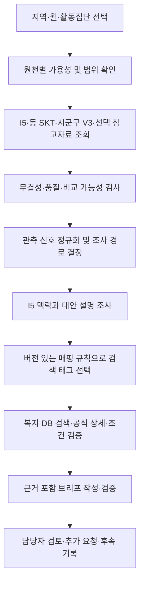

# 동행관측소 에이전트 설계서 v0.3

## 최신 결정 — 2026-10-25 ERD 대조 후 사용자 확정

공식 API 분류 + 별도 I5 영역 연결로 전환한다. 아래 9개 내부 태그 및 9태그 규칙 설명은
이전 설계 이력으로 대체되며 신규 계약에 적용하지 않는다. 활동신호와 I5의 조합 근거로
검색 의도를 정하고 출처별 공식 분류·I5 관련 사업을 조회한 후 내용·지역·대상·기간을 검토한다.
I5 임계값과 구체적 조합은 미확정이다. [구현 현황](implementation/step02/ERD_V2.md)을 따른다.

작성일: 2026-10-25 · 팀 공유 및 구현 검토용 · 단계별 구현 시작

## 구현 착수 상태

최신 사용자 요청에 따라 에이전트부터 단계별 구현한다. DB 매핑은 조합 규칙으로 태그 선택 → OR 검색 → 사업 내용·지역·대상·기간 검사 → 불일치 제외 → 추천 이유·미확인 조건 출력이다. 실제 지역 U의 원인이나 개인 욕구를 추가 조사하는 단계는 현재 구현에 포함하지 않는다.

[단계별 README](implementation/README.md)에 진행 상태를 기록한다. Step 01의 독립 매핑·사업 검토 코어와 합성 시험 8개를 구현하고 통과했다. 기존 graph·실제 복지 DB·서비스에는 아직 연결하지 않았다. 미확정 I5 임계값은 넣지 않았으며 근거가 있는 삼값 조건을 입력받는다. 후속 절의 과거 ‘코드 변경 없음’은 설계 당시 기록이다.

## 최신 사용자 결정 — 2026-10-25

아래 결정은 기존 제안·교차검증 기록보다 우선한다.

- **① 채택:** 기존 Rule·Robust·연속 감소 정의를 유지하고 신호별 조사 경로를 적용한다. 이는 설계 방향의 채택이며 고립 위험 등급의 실증 검증은 아니다.
- **② B 채택:** 활동신호와 I5를 함께 참고하는 조합 규칙으로 복지 분야를 선택하고 DB에서 사업을 검색한다. 사업 내용·지역·대상·기간을 확인하여 명백한 불일치 사업은 제외하고 추천 이유와 미확인 조건을 제시한다. 분야 선택 후 담당자 선택을 필수로 요구하는 중간 단계는 두지 않는다. 세부 조합 조건과 I5 활용 기준은 미확정이다.
- **③ 채택:** draft 매핑은 연구·시연에서 ‘제안 규칙’임을 표시하고 적용한다. 규칙·버전·입력 근거를 함께 제시한다. shadow 전용으로 제한하지 않는다. 다만 ②의 세부 조합 조건이나 미정 임계값을 임의로 채우지는 않는다. 평가 가능한 조건이나 명시적인 시연 입력을 갖춘 사례에 적용하고, 미정 조건은 unknown으로 남긴다.

**현재 목표 범위:** 조합 매핑 → DB 검색 → 사업 내용 및 적용 조건 검토 → 추천 이유·미확인 조건을 포함한 추천. 태그 일치만으로 추천을 확정하지 않는다. C 방식의 추가 맥락 조사로 실제 지원 필요를 확인하거나 분야를 다시 좁히는 단계는 후속 확장이다. 관측 신호 설명용 맥락·품질 확인과 사업 원문 검증은 현재 범위에 유지하되, 추가 욕구 조사 완료를 추천의 선행 조건으로 삼지 않는다.

문서 결정만 반영했으며 실행 코드는 변경하지 않았다.

## 1. 목적과 결정 상태

지역·집단의 활동변화 신호를 확인하고 I5 취약성 맥락과 공식 복지정보를 연결해, 담당자가 검토할 조사 이유·사업 후보·미확인 조건을 만든다. 개인 고립 진단이나 수급 자격 확정 시스템은 아니다.

이 문서는 사용자가 제공한 「AI 에이전트 설계 · 위험 탐지·판단 · 복지 대응」와 「복지 추천 매핑 설계 v0.2」, 현재 로컬 코드를 종합한 **목표 설계**다. 첨부 문서의 제안은 승인된 구현 요구로 승격하지 않았다.

| 표시 | 의미 |
|---|---|
| 확정 방향 | 사용자 제공 v0.2에서 채택한 아키텍처·책임 경계 |
| 현재 구현 | 로컬 소스에서 확인한 기능. 실제 운영·외부 호출 검증을 뜻하지 않음 |
| 설계 제안 | 이번 문서가 구체화한 신규 계약·분기·모듈. 팀 검토 후 구현 |
| 후속 합의 | 탐지 기준·비교 모집단·매핑 활성화 조건처럼 아직 정해야 하는 사항 |

**확정 방향:** I5와 V3를 별개 근거로 사용한다. 복지 내부 태그 9개를 사용한다. A는 복지 DB·검색, B는 매핑·추천 판단을 담당한다. 태그는 0~N개이며 원본 공식 분류를 보존한다. 연구용 `quality_status=hold`, `operational_alert_allowed=false`를 유지한다.

**이전 대화의 제안을 수정하는 점:** 임의의 ‘최우선 위험 등급’이나 새 위험점수를 도입하지 않는다. 공급 품질의 hold를 해제하지 않는다. 대신 자료 사용 가능성·관측 신호·조사 경로를 분리해 표현한다. I5만 있는 지역도 기초 분석을 완료할 수 있다.

## 2. 현재 구현과 목표의 차이

| 항목 | 현재 구현 | 목표 / 변경점 |
|---|---|---|
| I5 | 전국 번들 조회, 동·시군구 코드 및 해시 검증 | 5영역을 구조화한 맥락 입력과 비교 근거로 전달 |
| V3 | `get_final_behavior_evidence()` 존재. `measurements()`가 상위 시군구 자료를 `final_activity_context`로 추가 | Rule·Robust·지속성을 명시적 신호로 정규화하고 조사 분기 연결 |
| 품질 규칙 | 근거 누락, 구 SK 스냅샷 절대 변화율 ≥10%, 기준량 <1,000 | 원천별 사용 가능성, 비교 범위, 모델 reason_codes를 사용하는 검사로 확장 |
| 조사 그래프 | load → investigate → draft → review → finalize | 범위 해석·신호 판정·맥락 조사·태그 매핑 단계를 분리 |
| 정책 검색 | 로컬 공식 캡처 목록 검색·해시·조건 검사 | A의 9개 태그 검색 계약과 연결. 현재 `search()`는 태그 필터 구현이 아님 |
| 맥락 도구 | `get_context_evidence`는 unavailable 반환 | 검증된 커넥터를 추가하기 전까지 미확인 질문 유지 |
| 입력 범위 | 조사 요청은 10자리 동·20대/30대 중심 | 동/시군구와 V3 성·연령을 표현하는 v2 계약 도입 |
| 위험 등급 | 합성 `mock_graph.py`에만 40/70 기준 존재 | 실제 관측에 데모 위험점수·등급 사용 금지 |

첨부 ZIP의 ‘V3 미연동’은 현재 코드보다 이전 상태다. **조회 연동은 존재하지만 새 판단 흐름은 미구현**으로 정리한다. 현재 I5 어댑터도 기존 snapshot의 지역 해석 경로에 의존하므로, 전국 임의 지역의 새 조사 경로가 완성됐다고 보지 않는다.

## 3. 책임과 전체 흐름

- 모델팀: I5·Q/H/T·Rule·Robust·연속 감소 계산과 원천 계약을 소유한다.
- B/에이전트: 원천 어댑터, 신호 해석, 매핑 규칙, 사업 관련성, 설명 및 근거 검증을 소유한다.
- A/복지 DB: 사업 수집, 원문·버전, 공식 분류, 내부 태그, 조건과 검색 품질을 소유한다.
- 서비스팀: 요청·권한·비동기 실행·화면·검토 이력을 소유한다. 숫자나 태그 판정을 프런트에서 재계산하지 않는다.

## 4. 자료 조회 설계

자료 조회는 기본적으로 **검증된 모델 번들·DB에서 정확한 조건의 레코드를 읽는 것**이다. 외부 웹 조사와 구분한다.

| 원천 | 조회 키 | 반환할 값 | 없을 때 |
|---|---|---|---|
| I5 | 공간 수준, 지역코드, YYYYMM | `i5_reference`, E/P/O/C/U, 성인 인구·가중치·출처·품질 | 활동 자료가 있으면 활동 분석은 유지. I5 맥락만 미제공 |
| 동 SKT | 동 코드, 월, 원자료 성·연령 | 일평균, 전월 값·증감, 경계 및 품질 | 해당 분기만 생략. 동 카드 값을 생성하지 않음 |
| 시군구 V3 | 5자리 시군구, 월, MAN/WMAN, 20G~60GU | 두 원천 활동량·Q/H/T·Robust, Rule·연속 감소·reason_codes | I5 또는 동 SKT 근거로 진행 |
| C3 | V3가 반환한 `historical_reference_id` | 원래 비교기간·단위·카드 기준선 | 생략. 독립 세 번째 원천으로 집계하지 않음 |
| 서울 과거 지표·C1·설문 | 각 원천 고유 공간·기간·연령 키 | 원계약의 수치·범위·품질 | 생략. 전 지역 복제 금지 |
| I5 전국 영역 기준 | 동일 설문·산식 버전 및 명시적 기준 모집단 | 영역별 기준값·가중 방식·근거 ID | 비교 문장 생략. 지역 값만 표시 |
| 외부 맥락 | 원천의 공간·관측기간 | 달력·경계·기상 등 확인된 사실과 출처 | ‘미확인’ 질문 유지. 원인을 생성하지 않음 |

I5 전국 기준은 전국 성인 인구 가중 기준인지 다른 기준인지 명시하고 모델팀과 합의한다. 시군구 값의 단순 평균을 ‘전국 평균’으로 대체하지 않는다. 서로 다른 I5 영역의 원점수 순위만으로 가장 심한 욕구를 결정하지 않는다.

### 4.1 지역별 분석 경로

1. I5만 있음: 인구구성 참고 맥락 분석. 활동위험 판단은 `not_assessable`.
2. I5+동 SKT: 동 활동 변화 설명. 상위 시군구 자료는 별도 맥락.
3. 시군구 V3 있음: 선택 성·연령 셀의 Rule·Robust·연속 감소 분석.
4. 서울 참고자료 있음: 원래 기간·집단 조건에 맞는 경우만 별도 근거 추가.
5. 모든 근거 없음: `no_evidence`, 필요한 자료 제시. 정상·안전 판정하지 않음.

가용성은 현재 번들로 조회한다. 특정 도시를 코드에 영구 고정하지 않는다. 동 선택 시 상위 시군구 연결은 해당 월의 검증된 행정구역 레지스트리를 사용한다.

## 5. 품질 및 비교 가능성 검사

| 검사 | 구현할 비교 | 결과 |
|---|---|---|
| 무결성 | manifest 출력 목록·파일 해시·원 스키마 | 실패 원천은 격리. 실행 도중 고정 버전 변경은 실행 실패 후 재실행 |
| 존재 여부 | 요청 키의 행 존재, 필수 값 null, 원천 오류 | `missing`과 `error` 구분. 관측 0과 구분 |
| 산출 가능성 | 전월·당월, 로그 계산 조건, MAD·집단 수 | 불가한 파생 신호는 null 유지. 기준 임의 대체 금지 |
| 공간 | 선택 범위와 원천 spatial_unit/code | `exact` 또는 `parent_context`; 불명확하면 해당 비교 제외 |
| 모집단 | 성·연령, 관측장소/가맹점/주민 정의 | 집단 필터 일치 확인. 통신·카드를 같은 개인의 관측으로 결합하지 않음 |
| 기간 | 관측월·전월·연속 비교월, 참고자료 고정 시점 | 불연속 월을 연속 감소로 해석하지 않음 |
| 공급 품질 | `quality`, reason_codes, 경계·달력 정보 | 연구 사용 제한을 표시하고 운영 경보는 계속 불허 |
| 근거 중복 | 원천 lineage 및 파생 관계 | Q/H/T 세 개, 카드+C3를 독립 증거로 중복 계산하지 않음 |

**상태를 분리한다:** `evidence_use=usable_research|context_only|excluded`, `availability=available|missing|error`, `comparability=exact|parent_context|historical_context|incompatible`, `quality_status=hold`. 연구 자료를 쓸 수 있다는 판단이 공급 품질 승인이라는 뜻은 아니다.

구 SK 스냅샷의 10%/1,000 규칙은 해당 스냅샷 전용 조사 질문으로만 남긴다. 월 전월비 V3에 그대로 이식하지 않는다. 기존의 작은 기초량 경고도 새 원천 단위·분포를 검토한 설정이 있어야 활성화한다.

## 6. 위험신호 판단 설계

### 6.1 현재 모델 신호의 정의와 재사용 제안

ZIP §4.1은 아래 Rule·Robust·연속 감소의 정의를 제시한다. 다만 매핑 v0.2 §2.2·§4는 실제 사용할 신호 목록·채택 여부·최종 탐지 로직을 미확정으로 남겼다. 따라서 **기존 산출 정의는 확인된 사실이고, 이를 최종 에이전트의 발동 조건으로 채택하는 것은 설계 제안**이다.

| 신호 ID 제안 | 결정적 근거 | 의미·제약 |
|---|---|---|
| `single_source_decline` | 비교 가능한 원천의 Q>0 또는 원계약의 음의 전월 증감 | 원천별 활동 감소. 감소 크기의 새 임계값은 아직 없음 |
| `joint_decline` | V3 `rule.candidate=true` | 같은 시군구·월·성·연령 셀에서 SKT·카드 Q 모두 양수 |
| `relative_drop` | V3 `robust.candidate=true` 및 원천별 후보 | 실제 감소 Q>0이고 지역·월 10집단 상대변화 MAD z≥3.5인 원천 존재 |
| `persistent_decline` | V3 `rule.two_month_streak=true` | 두 비교월 연속 양원천 감소. 필요한 과거가 없으면 null |

Q=-ln(현재/전월), H=같은 지역·월 10집단 Q 중앙값, T=Q-H다. 모델의 원값·후보 플래그·유효성 상태를 사용한다. Robust의 3.5는 **기존 연구 탐지 기준**이지 고립 확률 임계값이 아니다. MAD=0·집단 부족은 false가 아니라 미산출이다.

각 신호는 `signal_id`, `source_record_id`, `source_family`, `scope`, `value=true|false|null`, `evidence_ids`, `reason_codes`, `model_version`을 보존한다. 상위 시군구 신호의 scope는 동으로 바꾸지 않는다.

### 6.2 조사 경로 결정 — 사용자 채택

| 조건 | `review_route` | 수행 업무 |
|---|---|---|
| 사용 가능한 근거 전혀 없음 | `insufficient_evidence` | 자료 필요 목록 |
| 활동 미보유·미산출, I5만 사용 가능 | `background_only` | I5 기초 맥락 분석 |
| 활동 비교 가능, 채택한 감소 신호 없음 | `routine_observation` | 현재 조건에서 탐지 신호 미발동 설명 |
| 단일 원천 감소 | `single_source_review` | 활동 크기·달력·거점 확인 |
| Rule만 발동 | `joint_change_review` | 두 원천 및 지역 공통 H 검토 |
| Robust 또는 연속 감소 발동 | `focused_review` | 특이성·지속성·기술적 대안 설명 심층 검토 |

복수 신호가 있으면 모두 보존하고 조사 경로만 focused → joint → single 순으로 선택한다. 이 순서는 **조사 업무 제안**이며 검증된 위험 서열이 아니다. 일부 필수 신호가 null이면 `assessment_completeness=partial`을 함께 기록한다. 모두 null인 활동자료를 routine으로 보내지 않는다.

I5가 높다는 이유만으로 조사 경로를 올리지 않는다. I5는 영역 맥락·복지 분야 선택에 사용한다. I5 임계값·영역별 비교 기준을 조사 우선순위에 쓰려면 별도 검증과 규칙 버전 승인이 필요하다.

### 6.3 LLM과 코드의 역할

에이전트의 판단 결과는 질문 목록에 그치지 않는다. ZIP §5에 따라 **무엇이 얼마나 달라졌는지, 왜 검토할 만한지, 가능한 다른 설명은 무엇인지, 무엇을 더 확인해야 하는지**를 근거와 함께 작성한다. 조사 경로 선택은 이 설명형 판단의 한 부분이다.

- 코드: 입력 검증, 신호·경로, 매핑 발동 조건, 수치·ID·조건 판정, 버전 관리.
- LLM: 조사 도구 선택, H/T 및 원천 차이 설명, 대안 설명·질문 작성, 근거 있는 사업 관련성 요약.
- LLM이 규칙에 없는 태그·위험점수·정책 ID를 확정할 수 없다. 제안은 별도 advisory 필드에 보관하고 결정 결과와 구분한다.
- 맥락 조회 실패는 고립 원인의 증거가 아니다. 일치하는 날씨·휴일 사실이 있어도 인과 확정은 하지 않는다.

## 7. 복지 태그 매핑

### 7.1 고정 태그 사전 — 확정 방향

| 코드 | 분야 |
|---|---|
| social_connection | 사회적 관계·참여 |
| isolation_outreach | 고립·은둔 발굴·상담 |
| mental_health | 정신건강·정서 지원 |
| employment | 취업·경제활동 |
| income_support | 소득·생활 안정 |
| housing | 주거 지원 |
| health_care | 건강·의료 |
| daily_living | 일상생활·돌봄 |
| family_support | 가족·보호자 지원 |

사업 태그는 A가 공식 지원내용에 근거해 부여한다. B는 사건별 검색 태그를 선택한다. 지역 위험 특성 때문에 사업의 저장 태그를 바꾸지 않는다. 공식 분류·내부 태그·대상 조건은 별도 필드다.

### 7.2 규칙 후보 — 모두 draft

| ID | 신호·맥락 후보 | 검색 태그 후보 | 추가 조건 |
|---|---|---|---|
| MR-01 | 양원천 감소 + P/C/U 참고 | social_connection | 영역 활용 기준 후속 합의 |
| MR-02 | 상대 급감 + C/U 참고 | isolation_outreach | 급감 대안 설명 검토 |
| MR-03 | 활동·결제 감소 + E 참고 | income_support | 주민 소득 감소로 단정 금지 |
| MR-04 | 활동 신호 없음/미보유 + P/C/U | social_connection | 예방적 탐색 모드의 별도 승인 필요 |
| MR-05 | 동 SKT 감소 + O 참고 | social_connection | daily_living 확장은 확인된 필요가 있을 때만 |
| MR-06 | 해당 매핑의 필수 근거 결측·범위 불일치 | 빈 배열 / 해당 규칙 보류 | 다른 유효 원천의 분석까지 중단하지 않음 |

E→income_support, P/O/C→social_connection, U→isolation_outreach/social_connection은 초기 후보 연결이다. employment·daily_living·family_support 확장은 확인된 필요 조건이 있어야 한다. mental_health·housing·health_care는 I5나 활동 감소만으로 발동하지 않는다. 지역 집계에서 개인 질환·실업·가구 형태를 추정하지 않는다.

ZIP §4.2·§9의 목표는 **I5만 있는 지역도 기초 분석에서 관련 분야·공식 정책 검색까지 이어가는 것**이다. 활동자료가 없다는 이유만으로 정책 탐색을 영구 차단하지 않는다. 다만 매핑 v0.2의 MR-04는 미확정이므로 실제 자동 선택 조건은 후속 합의가 필요하다.

사용자는 B 방식의 조합 매핑 후 DB 검색을 채택했다. 이전의 담당자 분야 선택을 필수로 하는 임시안은 기본 흐름으로 채택하지 않는다. I5만 있는 지역의 예방 탐색 조건은 별도 미확정이다. 자료 부재를 ‘활동 신호 미발동’으로 대체하지 않는다.

### 7.3 MappingRule 계약 — 제안

필수 필드: `rule_id`, `rule_version`, `review_status=draft|approved|retired`, `required_signal_ids`, `required_evidence`, `scope_policy`, `i5_condition`, `additional_context_condition`, `welfare_fields`, `priority`, `hold_reasons`, `reviewer`, `effective_from`.

- 조건 평가는 true/false/unknown이다. unknown은 발동하지 않고 확인 질문을 반환한다.
- 사용자 선택 ③에 따라 draft는 연구·시연에서 ‘제안 규칙’ 표시 후 적용한다. shadow 전용 제한은 채택하지 않는다. ②의 미정 결합 조건은 임의로 확정하지 않는다.
- 적용 규칙 없으면 태그 `[]`, `mapping_status=held`가 정상이다. 전체 태그 검색으로 자동 우회하지 않는다.
- 복수 태그는 OR 검색을 초기 제안으로 사용하되 A–B가 확정한다. 우선순위가 없으면 태그 정렬·사업 ID로 안정 정렬하며 임의 점수를 만들지 않는다.
- 결과에 `matched_rule_ids`, 적용 버전, 입력 근거, 선택/보류 이유를 기록한다.

### 7.4 다음 선택 항목 — 모두 미확정

1. **I5 영역 활용:** 같은 영역의 전국 기준 초과 / 비교 가능한 지역 중 상위 분위 / 높고 낮음의 컷오프 없이 관련 영역을 설명 맥락으로 사용. 앞의 두 안은 비교 기준 자료·버전과 임계값 합의가 필요하다. 서로 다른 영역 원점수를 비교한 상위 영역 선택은 사용하지 않는다.
2. **복수 영역 결합:** 활동신호 AND 관련 I5 영역 중 하나 이상 / 활동신호 AND 관련 영역 모두 / 대표 영역을 필수로 하고 다른 영역은 설명 보강. 어떤 영역을 어느 규칙에 연결할지는 MR별 후속 결정이다.
3. **활동자료 미보유:** 별도 I5 예방 탐색 규칙 / 자동 분야 선택 보류와 선택적 수동 탐색. 활동자료가 있고 신호가 false인 경우와 별도로 정의한다.

이 목록은 선택지이며 추천한 안도 답변 전에는 규칙에 반영하지 않는다. 사업 검토는 match/mismatch/unknown을 유지하고 unknown을 불일치로 처리하지 않는다.

## 8. 복지 DB 계약 및 추천 검증 — A–B 합의용 제안

`search_welfare(welfare_fields, match_mode, region, age_group, support_as_of, corpus_version, cursor)`

- 요청의 region은 코드체계·수준·코드를 포함한다. age_group은 원 활동집단 코드이며 정확한 개인 나이가 아니다.
- 반환: `program_id`, `program_version_id`, `title`, `source_category`, `program_tags`, `service_regions`, `age_conditions`, 기타 조건, 신청기간, URL, 취득일, 근거 ID, 검증 수준.
- `coverage`에는 조회 가능한 원천, 수집시점, 분류 완료/미분류 사업 수, 실패 원천, 페이지 정보를 포함한다. 미분류 사업은 일치 후보로 간주하지 않는다.
- 검색 실패와 검색 0건을 구분한다. 코퍼스 범위가 좁으면 ‘지원 없음’이 아니라 ‘현재 검색범위에서 후보 없음’이다.
- 사업 상세는 원문·추출문·조건 인용과 버전을 검증한다. 조건은 `match|mismatch|unknown`으로 평가한다.
- 확인된 지역·기간 등 필수 조건 mismatch는 제외한다. 개인 소득·가구·질환·정확한 나이는 집계 입력으로 확정할 수 없으므로 unknown이다. 연령 구간이 일부만 겹쳐도 unknown을 유지한다.
- 결과는 `review_candidate|needs_confirmation|excluded|source_hold`; 태그 일치는 자격 충족이 아니다.
- 순위는 검증 상태·지역 적용·승인 규칙 우선순위 등 명시된 기준을 사용한다. 점수와 가중치는 후속 합의 전 비워 둔다.

## 9. 출력 계약 — 신규 v2 제안

| 블록 | 필수 내용 |
|---|---|
| scope | 선택 지역·공간 수준·관측월·활동 성/연령·지원 기준일 |
| availability | 원천별 가용성·사용 여부·미사용 사유 |
| background | I5 전체/영역·인구구성·비교 기준 근거 |
| signals | 원값·true/false/null·원천 범위·근거 ID |
| assessment | review_route·완전성·판정 이유·대안 설명·추가 질문 |
| mapping | 태그·규칙 ID/버전·selection_origin·보류 사유 |
| support | 후보·제외·조건·coverage·사업 버전 |
| governance | quality_status=hold·operational_alert_allowed=false·자료/규칙/모델 버전 |
| review | awaiting_review 및 사람 검토·후속 이력 |

수치·판정 필드는 서버가 생성하고 LLM 설명과 분리한다. 설명의 근거 ID가 실제 이번 실행에 제공됐는지 확인한다. 자동 수치 대조가 실패하면 설명을 확정 브리프에 넣지 않는다. 사람의 accept는 브리프 검토 수락이며 품질 승인·지원 자격 승인·알림 발송을 의미하지 않는다.

## 10. 구현 변경 계획

| 위치 | 작업 제안 |
|---|---|
| `contracts.py` | 기존 v1 유지, scope를 가진 v2 요청·신호·매핑·브리프 타입 추가 |
| 신규 `evidence_adapters.py` | snapshot 의존 없는 I5/V3/동 SKT 가용성·조회·범위 정규화 |
| 신규 `assessment.py` | 원천별 사용 검사, 신호 정규화, 조사 경로 결정 |
| 신규 `mapping.py` + 규칙 리소스 | 삼값 조건·draft/approved·태그 선택·버전 |
| `tools.py` | 새 어댑터와 A 검색 연결, 기존 정책 검증 재사용 |
| `graph.py` | load→assess→investigate_context→map→search_verify→draft→review→finalize |
| `provider.py` | 새 읽기 도구와 설명 계약. 기존 호출 예산을 명시적으로 유지/조정 |
| `repository.py` / `worker.py` | 신호·규칙 버전 저장, 중단 재개, 멱등성·검토 충돌 유지 |

현재 5회 모델·12회 도구·2회 검색 예산을 넘는 설계를 암묵적으로 도입하지 않는다. 결정적 전처리와 반복 상세 조회를 서버에서 수행할지, 배치 도구를 추가할지 계약 검토 후 정한다. 모델 실패 시 성공한 AI 조사처럼 처리하지 않으며 결정적 중간 결과만 부분 결과로 보존한다.

## 11. 검증과 개발 순서

1. **입력 인벤토리:** 실제 번들의 지역·기간·집단·필드·가용성 표 작성. 모든 조회 키와 출처를 재현한다.
2. **결정적 신호 단계:** Rule/Robust/지속성·null·동/시군구 분리 구현. 모델 값과 대조한다.
3. **매핑 골격:** 9개 태그·버전·보류·A 검색 계약 구현. draft는 제안 규칙 표시 후 연구·시연에서 적용하며 미정 조건은 보존한다.
4. **규칙 합의:** I5 비교 기준, MR-01~06 발동·우선순위·확장 조건을 사례로 검토한다.
5. **서비스 통합:** 비동기 조사·브리프·사람 검토 연결.
6. **평가:** 공식 사업 10~20건과 아래 반례로 기술·추천 품질 검증. 현장 효과는 별도 평가다.

| 필수 시나리오 | 기대 결과 |
|---|---|
| I5만 있음 | 기초 분석 완료, 활동 not_assessable, 미승인 매핑 자동 발동 없음 |
| 활동만 있음 | 활동 조사 유지, I5 조건 규칙만 unknown |
| 동 I5 + 상위 시군구 Rule | 시군구 맥락 표시, 동 신호 생성 안 함 |
| 전월 0·null, MAD=0, 과거 비교월 부족 | 각 파생 신호 null 및 사유 |
| Rule/Robust/지속성 복수 발동 | 원래 신호 모두 유지, 제안 조사 경로만 선택 |
| 카드+C3, Q/H/T | 독립 원천 수 부풀리지 않음 |
| 해시 불일치·실행 중 버전 변경 | 손상 근거 배제 또는 실행 실패, 이전 결과 오용 차단 |
| draft 규칙·태그 없음 | 추천 보류, 질문 및 수동 탐색 경로 |
| 사업 지역 불일치·기간 종료·원문 변경 | 제외 또는 재검토. 자격 자동 확정 없음 |
| LLM이 모르는 정책 ID·근거·수치를 제시 | 검증 실패, 확정 결과에 반영 안 함 |

평가 보고에는 신호 재현 일치율, 근거 누락률, 과잉 태그 선택률, 조건 불일치 제외율, 보류 적절성, 처리시간·실패율을 기록한다. 고립 예측 정확도나 복지 효과는 해당 정답·현장 평가 없이 보고하지 않는다.

## 12. 근거 및 연계 문서

- 사용자 제공: `C:/Users/jssh2/Downloads/AI에이전트설계.zip` 내 「04 AI 에이전트 설계 · 위험 탐지·판단 · 복지 대응」.
- 사용자 제공: `C:/Users/jssh2/Downloads/donghaeng_welfare_mapping_design_v0_2.md`.
- [현재 에이전트 도구](../src/donghaeng_agent/tools.py), [그래프](../src/donghaeng_agent/graph.py), [입력 계약](../src/donghaeng_agent/contracts.py), [제공자](../src/donghaeng_agent/provider.py).
- [모델 데이터 사전](../../model/final_model/reports/DATA_DICTIONARY.md), [모델 계산](../../model/final_model/src/pipeline.py), [I5 스키마](../../model/final_model/schemas/survey_area_index.schema.json).
- [서비스 설계서 v0.3](../../service/docs/DONGHAENG_SERVICE_DESIGN_v0_3.md).

판단 근거는 첨부 본문과 로컬 소스다. 첨부에 적힌 외부 링크의 최신 원격 상태나 실제 배포 상태는 이번 문서 작성에서 검증하지 않았다.

## 13. 첨부 원문 교차검증 기록 — 2026-10-25

| 대조 항목 | 원문 위치 | 검증 결과 |
|---|---|---|
| I5·활동 별도 근거, 내부 태그 9개, A/B 역할 | 매핑 v0.2 §1 | 일치 |
| 자료 없는 원천만 생략, 공간·기간·집단 보존 | ZIP §2~3, 매핑 §3 | 일치 |
| 신호 정의와 최종 채택 구분 | ZIP §4.1 / 매핑 §2.2·§4 | 구분 문장 추가 |
| 설명형 판단의 역할 | ZIP §5 | 단순 조사 경로·질문 이상의 출력임을 명시 |
| I5만으로도 정책 탐색 | ZIP §4.2·§9 / 매핑 MR-04 | 목표를 복원하고 자동 보류·수동 선택은 과도기 제안으로 명시 |
| draft 승인·shadow 제한 | 매핑 §2.2 | 원문 확정 요구가 아닌 추가 제안으로 정정 |
| 수치·자격·운영 경보 제한 | ZIP §10, 매핑 §1.2 | 일치 |

문서 대조이며 성능·현장 효과 검증 또는 코드 실행 시험은 아니다.
