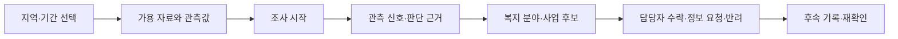
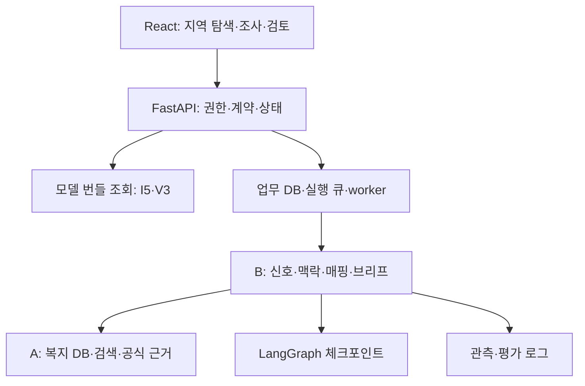

# 동행관측소 서비스 설계서 v0.3

## 최신 화면 교체 — HERMES Complete

사용자 제공 `HERMES_Complete.html`을 기본 화면으로 적용했다. 기존 모델 API·추천 그래프 연결은 유지한다. 대화·정책 초안·보고서와 자료 출처의 구분은 [Step 06](../../agent/docs/implementation/step06/README.md)을 따른다. 아래 Step 05 화면은 legacy 모드로 남긴 이전 구현이다.

## 최신 결정 — 2026-10-25

분야 필터는 출처별 공식 API 분류를 사용하고 I5 연결은 별도 근거로 표시한다.
아래 9개 내부 분야 UI·검색 계약은 이전 설계 이력으로 대체된다.
[새 DB 및 계약의 구현 상태](../../agent/docs/implementation/step02/ERD_V2.md)를 따른다.
서비스 API와 HERMES 6개 화면은 새 ERD 임시 DB 및 공통 추천 그래프에 연결했다. [Step 05 구현·검증 기록](../../agent/docs/implementation/step05/README.md)을 따른다. 아래 미구현 표시는 초기 설계 당시 이력이다.

작성일: 2026-10-25 · 팀 공유 및 구현 검토용 · 화면설계서 기반 구현 반영

## 구현 순서 갱신

에이전트 매핑·사업 검토 코어 → 실제 데이터/복지 DB 어댑터 → 조사 그래프 → 서비스 API → 웹 추천 화면 순으로 구현한다. 현재 에이전트 Step 01의 코어와 합성 시험 8개 통과까지 진행했으며 서비스 실행 코드는 아직 변경하지 않았다. [공통 진행 README](../../agent/docs/implementation/README.md)를 따른다.

웹은 서버가 반환한 추천·제외·검증 보류·미확인 조건을 표시하며 분야 판정을 재계산하지 않는다. 현재 범위는 DB 검색과 사업 내용·지역·대상·기간 검토까지다. 지역 U의 실제 원인·개인 욕구를 추가 조사하는 기능은 후속 확장이다.

## 최신 사용자 결정 — 2026-10-25

아래 결정은 기존 제안·교차검증 기록보다 우선한다.

- **① 채택:** 기존 신호별 조사 경로를 적용한다. Rule은 공통 요인 조사, Robust 또는 연속 감소는 심층 검토로 연결한다. 검증된 고립 위험 등급으로 표시하지 않는다.
- **② B 채택:** 활동신호와 I5의 조합 규칙으로 분야를 선택하고 DB에서 사업을 검색한다. 사업 내용·지역·대상·기간을 검토해 명백한 불일치는 제외하고 추천 이유와 미확인 조건을 표시한다. 분야 선택 후 담당자 확인을 필수로 받는 중간 단계는 두지 않는다. 세부 조합 조건과 I5 활용 기준은 미확정이다.
- **③ 채택:** 연구·시연에서 draft 매핑을 ‘제안 규칙 적용’으로 표시하고 사용한다. 규칙 ID·버전·관측 근거·미정 조건을 보여준다. shadow 전용 제한은 채택하지 않는다. ②의 세부 조합 조건이나 미정 임계값은 임의로 확정하지 않는다.

**현재 목표 범위:** 조합 규칙으로 분야 선택 → 사업 검색 → 내용·지역·대상·기간 검토 → 추천. 카드에는 관측 근거와 매핑 이유, 사업 내용의 관련성, 미확인 조건을 구분해 표시한다. C 방식의 추가 욕구 조사와 이를 통한 분야 재선정은 후속 확장이다. 공식 사업 상세 검증은 현재 범위이며 이 확장과 혼동하지 않는다.

문서 결정만 반영했으며 실행 코드는 변경하지 않았다.

## 1. 서비스 목표와 상태 구분

복지 담당자가 지역·관측월·활동집단을 선택하면, 보유 근거와 관측 신호를 확인하고 관련 복지사업 후보를 검토하며 후속 조치를 기록하는 업무지원 서비스다. I5와 활동변화를 하나의 위험점수로 합산하지 않는다.

이 문서의 **확정 방향**은 사용자 제공 복지 매핑 v0.2에서 가져왔다. 화면·v2 API·상태·저장 확장은 **설계 제안**이다. 위험신호별 복지 태그 발동 조건과 순위는 **후속 합의**다. 현재 코드 존재와 실제 운영 검증은 구분한다.

- 확정 방향: I5+V3 독립 근거, 내부 9개 태그, A의 복지 DB/검색과 B의 매핑/판단 분리.
- 연구용 `quality_status=hold`, `operational_alert_allowed=false` 유지.
- 담당자가 검토할 후보를 제공한다. 개인 진단·수급 확정·자동 연락·자동 신청은 범위 밖이다.
- 자료가 적어도 보유 근거로 분석한다. 자료 없음·미산출·오류·실제 0을 구분한다.

연계 규칙의 기준 문서는 [에이전트 설계서 v0.3](../../agent/docs/DONGHAENG_AGENT_DESIGN_v0_3.md)이다. 서비스는 위험·매핑 규칙을 별도로 정의하지 않는다.

## 2. 현재 서비스와 목표의 차이

| 항목 | 현재 소스 확인 | 목표 |
|---|---|---|
| 기본 실행 | `APP_MODE=final`, 모델 조회 라우터만 등록 | 모델 조회 유지 + 새 조사 API 선택적 활성화 |
| 화면 | FinalModelApp에서 전국 I5·시군구 활동 별도 조회 | 조사 시작·진행·추천·검토·후속 기록 연결 |
| 지도 | 서울 경계, 다른 지역은 목록/상세 | 기존 지원 범위 유지. 전국 지도 완성으로 표기하지 않음 |
| 조사 API | legacy 모드의 `/api/investigations`, 10자리 동·20대/30대 계약 | 동/시군구·V3 10집단을 표현하는 v2 병행 |
| 실행·검토 | agent 저장소·worker·중단/재개·검토 API 존재 | v2 브리프와 새 화면에 연결 |
| 복지 | 로컬 공식 캡처 검증 및 목록 검색 | A의 9개 태그 검색·사업 버전·coverage 연결 |
| 보안 | JWT/로컬개발 접근 경계, read/investigate/review/admin | 신규 경로 권한 매핑 및 실제 접근 검증 |
| CORS | final 모드는 GET만 허용 | 조사 기능 활성화 시 허용 출처와 필요한 POST 추가 |

기존 InvestigationPanel 파일이 존재하는 것만으로 final 화면에서 새 흐름이 사용 가능하다고 보지 않는다. 기존 조사 계약을 5자리 시군구로 묵시적으로 바꾸지 않는다.

## 3. 사용자 흐름과 화면 구성



### 3.1 지역 탐색 화면

- 시도 → 시군구 → 행정동을 실제 코드 레지스트리로 선택한다. 이름은 표시용이며 조회 키로 쓰지 않는다.
- 관측월과 지원정보 기준일을 구분한다. 과거 활동을 분석하면서 현재 지원정보를 찾을 수 있지만 두 시점을 명시한다.
- 성·연령 필터에는 ‘활동자료 대상’이라고 표시한다. I5가 선택 성·연령 점수로 바뀌는 것처럼 보이지 않게 한다.
- 초기 가용성 카드: I5 / 동 SKT / 시군구 V3 / 추가 참고자료의 보유·미보유·오류 상태.
- I5 지도색은 ‘인구구성 취약성 참고값’ 범례를 유지한다. ‘고립자 비율’이나 새 종합 위험등급으로 변경하지 않는다.
- 값이 없는 원천의 그래프는 숨겨도 ‘자료 범위’에는 미보유·오류 사유를 남긴다.

### 3.2 조사 시작 및 진행

사용자는 ‘조사 브리프 만들기’를 실행한다. 서버는 선택 범위·버전·관측월·지원 기준일을 고정하고 비동기 실행 ID를 반환한다.

진행 단계는 ‘자료 확인 → 관측 신호 정리 → 맥락 확인 → 복지 분야 선택 → 사업 조건 검토 → 브리프 작성 → 담당자 검토’다. 완료되지 않은 단계를 완료로 표시하지 않는다. 현재 worker의 실제 이벤트를 새 단계에 맞춰 매핑한다.

LLM 또는 복지 검색이 실패하면 성공한 관측 단계는 부분 결과로 표시하고 실패 단계·재시도 가능 여부를 제공한다. 규칙 결과만 있는 경우 ‘AI 조사 완료’로 표시하지 않는다.

### 3.3 관측·판단 화면

ZIP §7.1의 목표 UX를 반영해 **에이전트 대화 안에서 근거를 펼쳐보는 방식**을 중심으로 한다. 아래 표·후보 카드·검토 기능은 대화와 연결된 근거 패널로 구성하는 제안이며, 별도 탭만 있는 대시보드로 대체하는 것으로 확정하지 않는다.

| 영역 | 표시 내용 |
|---|---|
| 대상 | 선택 지역·공간 수준·월·활동 성/연령 |
| I5 | 전체·5영역·성인 인구구성·참고지수 설명 |
| 활동 | 원천별 전월/당월·증감률·단위 |
| 신호 | 양원천 감소 / 상대 급감 / 두 비교월 연속 감소 및 각각의 발동·미발동·미산출 |
| 조사 경로 | 기초 맥락 / 단일 원천 / 공동 변화 / 심층 검토 등 서버의 review_route |
| 근거 펼침 | Q/H/T·Robust z·reason_codes·출처 버전·대안 설명 |
| 남은 확인 | 미확인 맥락·자료 요청·판단 제한 |

‘심층 검토’는 조사 순서 제안이며 확정 고립 고위험 등급이 아니다. 자료가 비교 가능하고 신호가 false인 경우에도 ‘안전’ 대신 ‘현재 조건에서 해당 신호 미발동’이라고 표시한다.

동을 선택했을 때 상위 시군구 자료에는 ‘상위 시군구 참고’ 배지를 붙인다. 분석 카드와 내보낸 브리프 모두 이 범위를 유지한다.

### 3.4 복지 분야 및 후보 화면

- 내부 9개 분야: 사회적 관계·참여, 고립·은둔 발굴·상담, 정신건강·정서, 취업·경제활동, 소득·생활 안정, 주거, 건강·의료, 일상생활·돌봄, 가족·보호자.
- 태그마다 선택 근거·규칙 ID/버전·선택 주체를 펼쳐 볼 수 있게 한다.
- 사용자 선택 ③에 따라 연구·시연에서 draft 규칙을 적용하고 ‘제안 규칙 적용’으로 표시한다. ②의 미정 결합 방식·임계값은 임의로 채우지 않는다.
- 태그 0개면 ‘자동 분야 선택 보류’와 사유를 표시한다. 사용자가 분야를 직접 고르면 ‘담당자 선택’으로 기록한다.
- 후보 카드: 사업명, 관련 이유, 공식 지원내용, 적용 지역·대상·기간, 확인한 조건, 미확인 조건, 공식 URL·취득일.
- 상태 탭: 검토 후보 / 추가 확인 / 제외 / 자료 검증 보류. 별도 coverage 안내로 미분류·수집범위 제한 표시.
- 검색 0건, 검색 실패, 미분류로 검색범위가 좁음은 다른 상태다. 어떤 경우에도 ‘복지사업이 존재하지 않음’으로 일반화하지 않는다.

### 3.5 검토·후속 업무 화면

검토자는 수락 / 추가 정보 요청 / 반려를 선택하고 이유를 기록한다. 수락 전 데이터·공식 사업·규칙의 변경 여부를 확인한다. 변경되면 기존 브리프를 덮어쓰지 않고 재실행·새 버전을 만든다.

수락은 **브리프 검토 수락**이다. 사업 자격 승인이나 실제 서비스 연계 완료가 아니다. 후속 기록은 기존 `referral_reported`, `connection_confirmed`, `participation_confirmed`, `closed` 계약을 검토해 재사용하며 행위자·일시·근거를 함께 저장한다. 지역 사례에 개인 식별정보나 건강정보를 입력하도록 유도하지 않는다.

## 4. 화면 상태 정책

| 상황 | 화면 처리 | 다음 행동 |
|---|---|---|
| I5만 보유 | 기초 분석 및 관련 분야 정책 탐색이 목표, 활동 자료 없음 | 자동 매핑 조건은 후속 합의. 수동 선택은 규칙 확정 전 임시 구현 제안 |
| V3만 보유 | 활동 근거 분석, I5 맥락 없음 | I5 조건이 필요한 매핑만 보류 |
| 원천 일부 미보유 | 해당 그래프 생략, 자료 범위 표시 | 나머지 근거로 진행 |
| 활동 0 관측 | 0 표시, 증감 산출 여부 별도 | 로그 신호 불가 사유 확인 |
| 신호 미산출 | ‘계산 불가/비교 근거 부족’ | 필요한 자료 안내 |
| 해시·스키마 오류 | 해당 자료 사용 중단·오류 표시 | 정상 번들 연결 후 재실행 |
| 모든 근거 없음 | 조사 근거 없음 | 지역/월 변경 또는 자료 연결 |
| hold | 연구 검토용 배지 | 경보·자동 연락 버튼 제공 안 함 |
| 매핑 보류 | 태그 없음 + 보류 이유 | 추가 맥락 또는 담당자 선택 |
| 지원 원문 갱신 | 기존 결과에 ‘재검토 필요’ | 새 버전 조회·재검토 |

실행 상태와 분석 상태를 섞지 않는다. 예컨대 `execution=completed`여도 `activity=not_assessable`, `mapping=held`, `quality=hold`일 수 있다.

## 5. 시스템 구성과 책임



- 모델 번들은 읽기 전용으로 사용한다. 서비스가 점수·Rule·Robust를 다시 계산하지 않는다.
- 업무 저장소와 체크포인트를 구분한다. 로그는 업무 상태의 원본 저장소가 아니다.
- A의 DB 엔진·API 3종의 정확한 엔드포인트·수집주기·실시간 최신성 SLA는 현재 첨부와 코드로 확정하지 않는다. A의 수집 명세와 합의할 후속 항목이다.
- 새 조사 기능은 기능 설정으로 켠다. 모델 조회만 필요한 설치는 agent/worker/LLM 미구성 상태에서도 동작한다.

## 6. API 설계

### 6.1 기존 조회 API — 유지

| 경로 | 현재 용도 |
|---|---|
| GET `/api/model/status`, `/api/health` | I5·활동 번들 준비 상태 |
| GET `/api/model/regions` | 실제 지역 목록 |
| GET `/api/model/survey-area` | 동/시군구 I5 |
| GET `/api/model/behavior` | 시군구·월·성·연령 V3 |
| GET `/api/research/i5` | 호환 I5 조회 |

기존 `/api/investigations`는 legacy 모드 계약으로 남긴다. 이를 새 API가 이미 구현된 근거로 사용하지 않는다.

### 6.2 신규 v2 — 아래 경로는 제안, 아직 미구현

| 메서드·경로 | 역할 |
|---|---|
| GET `/api/v2/investigations/readiness` | 원천별·복지·worker·모델 가용성과 기능 목록 |
| GET `/api/v2/availability` | 선택 범위의 자료 가용성 및 상위 공간 관계 |
| POST `/api/v2/investigations` | 조사 사건 생성, 201 |
| GET `/api/v2/investigations` | 권한 범위 내 목록 |
| GET `/api/v2/investigations/{id}` | 사건·실행·브리프 버전 |
| POST `/api/v2/investigations/{id}/runs` | 실행 큐 등록, 202 |
| GET `/api/v2/investigations/{id}/events` | cursor 기반 진행 조회, 폴링부터 구현 |
| POST `/api/v2/investigations/{id}/retries` | 실패 실행의 명시적 재시도 |
| POST `/api/v2/investigations/{id}/reviews` | 수락·반려·추가 요청 |
| POST `/api/v2/investigations/{id}/rechecks` | 보관 근거·버전 재확인 |
| POST `/api/v2/investigations/{id}/followups` | 후속 근거 기록 |
| POST `/api/v2/investigations/{id}/welfare-searches` | 담당자 태그 선택을 포함한 검색·이력 저장 |

대화형 추가 질문은 읽기·설명 요청과 상태 변경 명령을 분리한다. 자연어 대화만으로 수락·신청·연계를 실행하지 않는다.

### 6.3 생성 요청 예시 — 형식 예시이며 실제 탐지 결과 아님

```json
{
  "scope": {
    "region": {"code_system": "KR_ADMIN", "level": "sgg", "code": "11680"},
    "measurement_month": "202510",
    "activity_population": {"sex_code": "MAN", "age_code": "20G"}
  },
  "support_as_of": "2026-10-25",
  "purpose": "지역 활동변화와 관련 지원 후보 검토",
  "idempotency_key": "example-create-20261025-001"
}
```

`KR_ADMIN`은 제안하는 내부 코드체계 식별자이며 외부 원천 계약과의 대응표가 필요하다. 지역은 이름이 아니라 코드와 해당 월 레지스트리로 검증한다. I5의 모집단은 요청 활동집단과 독립적이다. 동 선택은 `level=administrative_dong` 및 10자리 코드로 표현하고 상위 지역은 서버가 검증한다.

활동집단을 생략한 경우의 기본안은 각 성·연령 셀을 개별 반환하는 것이다. 집단을 자동 합산하거나 최댓값을 전체 지역 위험으로 표시하지 않는다. UI MVP는 하나의 활동집단 선택을 요구해 이 분기를 단순화할 수 있다.

### 6.4 응답·오류 공통 계약

응답에는 `schema_version`, `case_id`, `execution_id`, `case_version`, `source_versions`, `assessment`, `mapping`, `support`, `governance`를 포함한다. 세부 결과 블록은 에이전트 설계 §9와 동일하다.

- 누락 원천은 정상 응답의 availability로 표현한다. 조회 오류는 오류 코드와 분리한다.
- 401/403: 인증·권한, 404: 사건 없음, 409: 버전 충돌·stale, 422: 잘못된 범위·계약, 503: 필수 실행 구성요소 사용 불가.
- 202는 실행 완료가 아니라 접수다. 중복 명령은 idempotency_key와 본문 해시로 동일 응답을 재현하고 다른 본문 재사용은 거부한다.
- 원본 `true|false|null`을 프런트에 보존한다. null을 false로 변환하지 않는다.
- 모든 페이지를 cursor/offset 계약에 따라 조회한다. 일부 페이지만 읽고 전체 사업·지역 수로 표시하지 않는다.
- 외부 모델·검색 실패 시 `error.code`, 실패 단계, 재시도 가능 여부를 반환하며 비밀값·원문 개인정보를 출력하지 않는다.

## 7. A–B–서비스 연동 계약

공통 필드: `welfare_fields[]`, `region`, `age_group`, `support_as_of`, `corpus_version`, `program_version_id`, `evidence_ids`.

| 소유 | 생성·검증하는 항목 |
|---|---|
| A | 공식 원문·분류·program_tags·조건·버전·coverage |
| B | 신호·I5 맥락·선택 태그·규칙 버전·관련 이유·조건 검사 결과 |
| 서비스 | 사용자 선택·권한·case/execution 식별자·검토 명령·이력 표시 |

검색 기본안은 복수 태그 OR이며 아직 A–B 합의 대상이다. A가 지원하지 않는 검색 조건을 서비스가 적용된 것처럼 표시하지 않는다. 나이·가구·소득 미확인 사업을 임의로 적합/부적합 처리하지 않고 unknown으로 전달한다.

복지 API 연결 전에는 현재 캡처 코퍼스 모드를 명시한다. 새 DB가 연결됐더라도 각 사업의 수집시점·검증 수준을 표시한다. 로컬 해시 재확인을 ‘현재 웹 원문 최신성 확인’이라고 표현하지 않는다.

## 8. 저장·실행·권한

### 8.1 논리 저장 항목 — 기존 구조 확장 제안

| 항목 | 기록 내용 |
|---|---|
| 사건 | 범위·목적·생성자·기관·case_version |
| 실행 | 고정 입력·원천/규칙/모델 버전·단계·상태·오류 |
| 근거 | 원 레코드·공간/기간/집단·원천 계보·해시 |
| 판단·매핑 | 모든 신호·조사 경로·규칙·태그·보류 이유 |
| 사업 후보 | 사업/코퍼스 버전·조건·근거·포함/제외 이유 |
| 브리프 | 불변 버전·생성 시점·검증 결과 |
| 검토·후속 | 행위자·일시·결정·근거·검토 대상 버전 |

처음부터 새 DB로 갈아엎지 않고 기존 repository/worker/checkpointer에 필요한 필드를 추가한다. 데이터베이스 변경은 백업·마이그레이션·복원 시험을 포함한다.

### 8.2 실행 상태 — 신규 외부 계약 제안

`queued → running → awaiting_review → reviewed`를 기본으로, `failed`, `needs_info`, `rejected`를 구분한다. 기존 내부 상태와의 대응표는 구현 시 확정한다. 연구용 hold는 실행 상태가 아니므로 이 상태열에 넣지 않는다.

worker 재시작 시 체크포인트에서 이어 가되 버전 고정·중복 작업 방지 규칙을 유지한다. 자료·규칙이 바뀌었으면 같은 실행을 몰래 새 버전으로 재개하지 않는다. 검토는 optimistic lock으로 오래된 화면의 수락을 거부한다.

### 8.3 권한과 운영

- 기존 `read`, `investigate`, `review`, `admin`에 신규 경로를 명시적으로 매핑한다. 경로 이름만 추가하면 기존 인증 미들웨어가 자동 보호한다고 가정하지 않는다.
- 기관 모드는 현재 단일 기관 인스턴스/DB 경계를 유지한다. 멀티테넌트 완료로 표시하지 않는다.
- 개인 구독 모델과 기관 승인 모델 구성을 구분한다. 기관 제공자 미구성 시 LLM 실행 불가 상태를 노출한다.
- API 키·원문 보관 경로는 브라우저로 보내지 않는다. 관측 로그는 필요한 비식별 집계와 ID 중심으로 기록한다.
- 운영 환경에서 모델 번들·코퍼스·업무 DB·체크포인트의 경로 및 백업 책임을 지정한다. 갱신은 버전을 추가하고 진행 중 실행을 보존한다.
- CORS POST 허용, 인증 헤더, 브라우저 preflight, worker 기동/종료, readiness를 통합 검증한다.

## 9. 구현 순서와 담당 경계

| 단계 | 담당 | 산출 및 완료 조건 |
|---|---|---|
| 1 입력·계약 정리 | 모델+B+서비스 | 실제 자료 가용성 표, 범위·null·버전 계약 |
| 2 검색 DB 골격 | A | 9개 태그·원문·사업 조건·coverage 검색 계약 |
| 3 판단·매핑 골격 | B | 신호 재사용, 조사 분기, draft 규칙·보류 출력 |
| 4 v2 API·worker 연결 | 서비스+B | 시군구/동 요청, 비동기 실행, 권한·멱등성 |
| 5 화면 연결 | 서비스 | 지역→근거→후보→검토 흐름, 부분 결과·오류 처리 |
| 6 규칙 승인·사례 평가 | A+B+검토자 | I5 기준·MR 규칙·태그 순서 합의와 반례 통과 |
| 7 운영 검증 | 서비스+운영 담당 | 배포·접근·백업·관측·장애 복구 확인 |

위험 매핑이 미확정이어도 1~5의 구조·조회·보류·수동 탐색은 개발할 수 있다. 확정되지 않은 매핑을 임시 기본값으로 자동 발동시키지 않는다.

## 10. 인수 테스트와 시연 시나리오

| 시나리오 | 화면/API 인수 조건 |
|---|---|
| 전국 I5만 있는 지역 | 활동 없음에도 브리프 생성, 자동 위험등급 없음 |
| 동 선택·상위 시군구 자료 | 카드/V3가 상위 맥락으로만 표시 |
| V3 보유 지역·집단 | 모델 원값과 신호 표시 일치, I5 모집단 독립 표시 |
| 서울 과거자료 | 417동 2025.12·20~39세 범위 유지, 427동 전체로 복제 안 함 |
| 자료 null/0/오류 | 세 상태가 API·화면·브리프에서 구분됨 |
| 매핑 0태그 | 보류 이유와 담당자 선택 경로, 전체 태그 자동 검색 없음 |
| 검색 실패/0건/미분류 | 서로 다른 문구 및 coverage |
| 오래된 결과 수락 | 409와 재검토 안내, 기존 브리프 보존 |
| 브라우저 선택 빠른 변경 | 이전 응답이 새 지역 화면에 덮어쓰지 않음 |
| 새로고침·worker 재시작 | 실행 추적·검토 상태 복원, 중복 생성 없음 |
| 권한 없는 조사·검토 | 403, 데이터/상태 변경 없음 |
| LLM 실패 | 규칙 결과는 부분 표시, AI 완료로 위장 안 함 |

검증은 실제 브라우저→API→agent→모델/A 검색→저장→검토 흐름에서 수행한다. 문서의 시나리오는 평가 계획이며 통과 결과가 아니다. MVP 완료는 운영 경보 승인이나 현장 복지 효과 입증과 구분한다.

## 11. 후속 합의 목록

1. I5 영역 비교 기준의 산출·버전·모집단 및 매핑 사용 조건.
2. 조사 경로의 명칭·우선순위와 draft 규칙 승인 담당자.
3. A의 API 3종 목록·원문 보존·갱신주기·분류 검토·검색 coverage 계약.
4. 복수 태그 OR/AND, 사업 정렬, 태그 미분류 노출 방식.
5. 실제 동 SKT 조회 어댑터와 지역별 제공 기간·성/연령 범위.
6. 지원정보 기준일과 현재 접수 여부의 검증 책임.
7. 기관 모델 제공자·배포 환경·보관기간·운영 및 장애 책임자.

## 12. 근거

- 사용자 제공 `AI에이전트설계.zip` 및 `donghaeng_welfare_mapping_design_v0_2.md`.
- [에이전트 설계서 v0.3](../../agent/docs/DONGHAENG_AGENT_DESIGN_v0_3.md).
- [서비스 README](../README.md), [현재 모델 연결 계약](FINAL_MODEL_INTEGRATION.md).
- [현재 진입점](../backend/app/main.py), [모델 API](../backend/app/final_model_api.py), [기존 조사 API](../backend/app/investigation_api.py), [접근 통제](../backend/app/security.py).
- [현재 화면](../frontend/src/FinalModelApp.tsx), [기존 조사 계약](../../agent/src/donghaeng_agent/contracts.py).

외부 API 최신 사양·법적 요건·운영 배포 완료를 주장하는 문서가 아니다. 현재 확인한 로컬 코드와 제공 설계 자료를 기준으로 작성했다.

## 13. 첨부 원문 교차검증 기록 — 2026-10-25

- ZIP §7.1의 ‘에이전트 대화 안에서 근거 펼침’을 목표 UX에 명시했다.
- ZIP §9의 I5 단독 지역 정책 탐색 목표를 유지하고, 자동 보류·수동 분야 선택은 원문 확정이 아닌 임시 구현 제안으로 분리했다.
- 매핑 v0.2 §2.2는 draft를 확정 로직처럼 표시하지 말라는 요구다. shadow 전용 제한과 별도 승인 절차는 추가 설계 제안으로 명시했다.
- 신규 v2 API·상태 코드·모듈·저장 항목은 첨부 원문에 있는 확정 사양이 아니라 구현 구체화 제안이다.
- 설명형 판단·9개 분야·조건 검토·담당자 후속 기록·연구용 hold 유지 방향은 원문과 일치한다.

문서 대조 결과이며 실제 배포·외부 API·추천 성능을 검증한 결과는 아니다.
