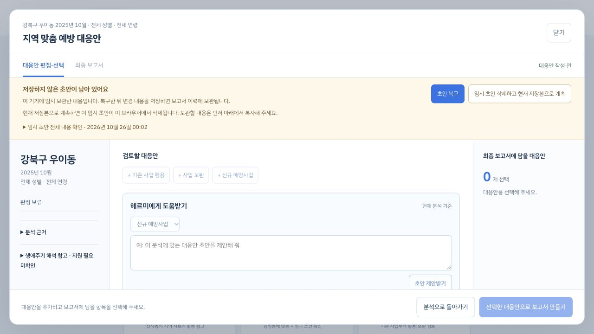
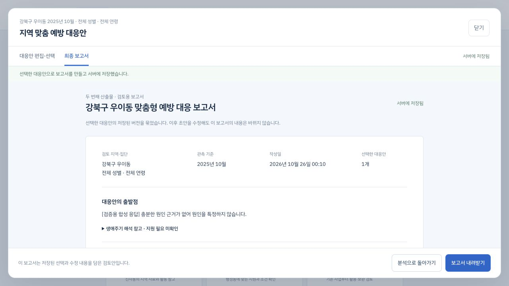
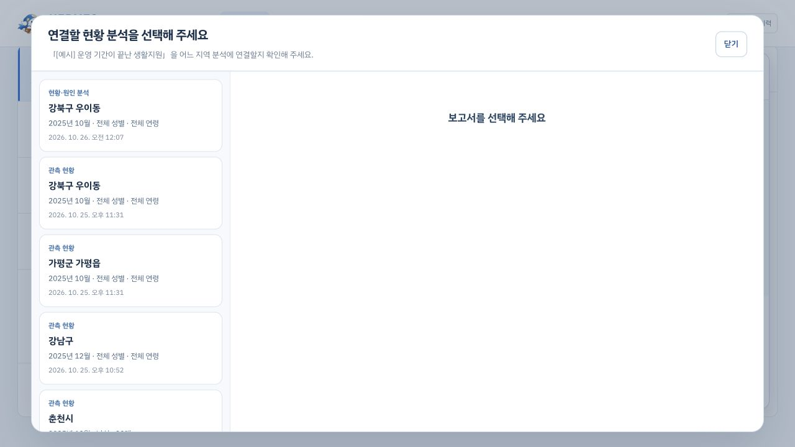

# 분석·대응 보고서 연결 수정 기록

2026-10-26, `codex/repair-report-flow` 작업본. 첨부 서비스 흐름도를 기준으로 한 감사 결과와 사용자의 우선순위별 수정 요청을 반영했다.

## 반영한 동작

| 문제 | 반영 |
| --- | --- |
| 원인 조사 후 대응안이 비어 보임 | 원본·파생 분석이 대응안·수정 이력·완성 보고서를 함께 조회한다. 완성 보고서가 사용한 분석 스냅샷은 그대로 유지한다. |
| 다른 조건의 초안을 이전 분석에 저장 | 지역·월·성별·연령·공간 단위를 대조하고, 불일치 시 연결 저장을 막아 원래 분석으로 돌아가도록 안내한다. |
| 복지 대화의 보고서가 공통 이력과 분리 | 사업 설명 대화와 보고서 작성을 구분했다. 보고서 CTA와 보고서 요청 문구는 저장된 분석 선택 → 공통 대응안 편집으로 연결된다. |
| 지역 비교가 원인 조사에 미전달 | 저장 보고서를 선택하면 서버가 같은 조건과 자료 버전을 검증하고 비교 관측·출처 버전을 조사 입력과 결과에 보존한다. |
| 새로고침·이동 중 초안 손실 | 분석별 기기 임시 저장·선택적 복구·이탈 보호를 추가했다. 최신 서버 저장본과 충돌하면 덮어쓰지 않고 모든 입력을 열람·복사할 수 있다. |
| 저장 상태와 다음 단계 혼선 | 현황 보고서 저장과 원인 조사 상태를 표시하고, 대응안 검토는 선택이며 나중에 이어갈 수 있음을 안내한다. |

기존 대화 편집기도 필터 전환, 같은 조건 새로고침, 메뉴 왕복, 브라우저 재진입에서 입력을 보존한다. 서버 저장 내용으로 입력을 되돌리면 취소한 중간 임시 초안은 정리된다.

## 검증

- 프런트 전체: **393 passed**, 21개 시험 파일. `npm --prefix service/frontend test`.
- 백엔드 전체: **374 passed, 17 skipped**, 14 subtests passed.
- 에이전트 전체: **403 passed, 13 skipped**, 65 subtests passed.
- 프런트 production build, 변경 공백 검사, HTML 재생성의 멱등성과 자산 해시 일치 확인.
- 독립 통합·UI 리뷰에서 확인한 네 P2 항목을 회귀 검사 후 수정했고, 한 차례 재리뷰에서 모두 ADDRESSED 판정을 받았다.

브라우저 검증은 기존 SQLite의 **별도 복사본**과 로컬 예시 복지 자료에서 진행했다. 실제 입력 → 새 페이지의 초안 복구 → 저장 → 예방 보고서 생성 → 원래 분석에서 파생 보고서의 대응안·완성 보고서 재열람을 확인했다. 비교 조건 차단·취소 복귀와 복지 보고서 CTA의 분석 선택도 확인했다. 원인 조사 파생 문서는 검증용 합성 응답으로 만들었고 외부 모델을 호출하지 않았다.

검증 뒤 기존 로컬 API를 새 코드로 재시작했다. `http://127.0.0.1:5176/`에서 사용하며, 기존 현황 보고서 5건과 공통 작업공간 응답을 확인했다. 검증용 합성 보고서와 대응안은 실제 기록에 넣지 않았다.

## 화면

아래 복구·완성 보고서 이미지는 검증용 복사본이다. `live-saved-report.png`는 기존 로컬 기록을 읽은 화면이다.

## 유지한 계약과 선택

- 기존에 양쪽 작업공간에 따로 저장한 대응안은 모두 보존한다. 사실상 중복인 안도 자동 삭제하지 않는다. 병합 시 버전을 올려 먼저 열린 편집기의 저장 충돌을 감지한다.
- 이전 완성 보고서의 실제 분석 ID·스냅샷·기존 작업공간 ID는 수정하지 않는다. 계열 소속이 확인된 목록에서 원래 보고서를 열 수 있도록 읽기 검증과 생성 검증을 구분한다.
- 신규 대응안 추가 제한은 20개를 유지한다. 기존 기록 병합으로 이미 20개를 넘은 묶음은 내용 손실 없이 수정·선택·보고서 생성을 허용한다.
- 비교는 저장된 전체 자료 버전이 같을 때만 허용한다. 다른 비교 선택은 별도 조사 결과로 저장하며, 기존 비교 결과의 재조사는 선택을 유지한다. 비교 제거는 명시적 빈 배열 요청이다.
- I5의 인구구성 참고 의미, 활동의 시군구 단위, 품질 보류·운영 경보 불허를 유지한다.

실제 외부 AI의 조사·초안 품질과 선택적 원격 통합은 이번에 검증하지 않았다. 위 skip은 환경 의존 기존 통합 항목이며 실행 성공으로 계산하지 않았다. 10월 25일 별도 와이어프레임은 이전 설계 예시이므로 현재 동작은 이 문서와 실행 화면을 기준으로 확인한다.

커밋·푸시·배포 없이 로컬 작업본에 반영했다. 작업 전의 변경을 보존했으며 상세 설계·구현·리뷰 기록은 `../../docs/superpowers/`에 있다.
